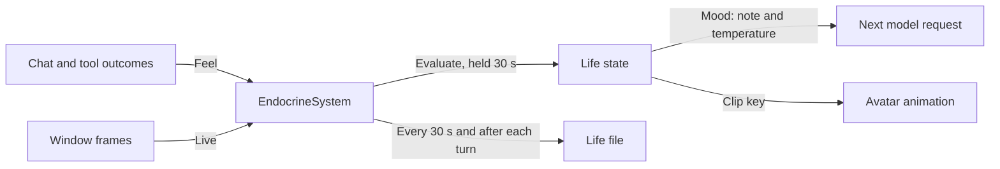
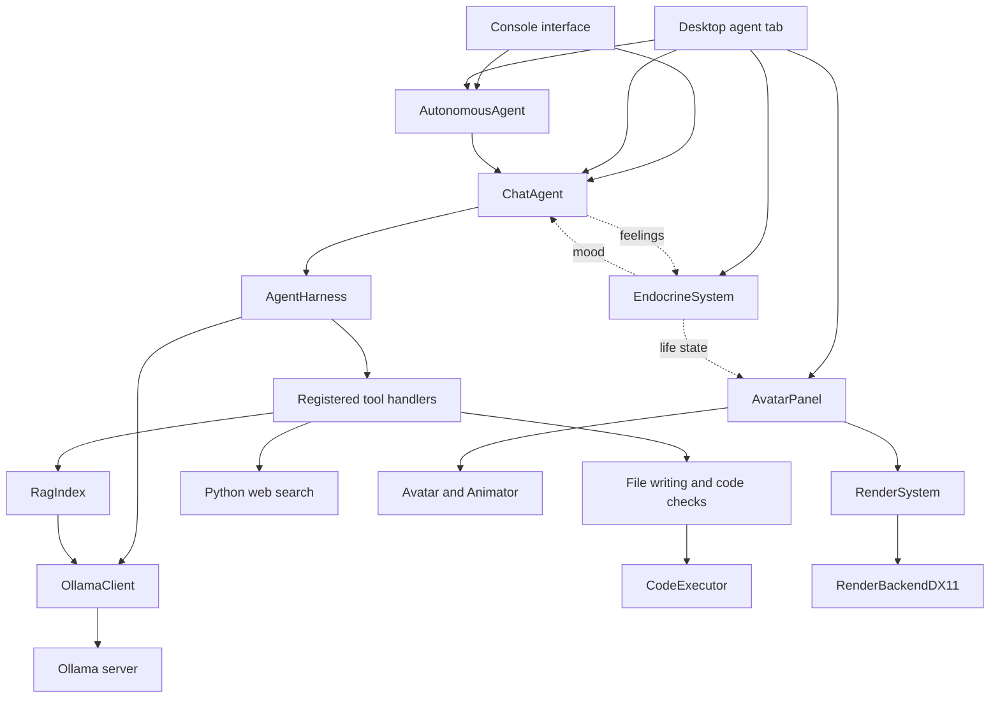

# Local AI Agent

> **Dedicated to Sofia.** The default assistant, **Sof_IA**, is named after the author's daughter.

A native **C++17 AI assistant for Windows**, powered by models served through **Ollama**. Chat through a desktop window or the command line, search a local document collection, retrieve information from the web, and create or execute scripts on your computer.

The default assistant is **Sof_IA** (Sofia). The desktop interface also supports additional agents with their own names, models, instructions, and conversations.

In the desktop interface, each agent also has a simulated **body**: seven hormones react to how its work goes, settle over time, and add up to one of six life states. The state adjusts the tone note and sampling temperature of the agent's next model request, and a **3D avatar** beside the conversation plays an animation for that state.

The application implements its own tool-calling harness, retrieval index, execution layer, endocrine simulation, animation system, 3D renderer, and GUI integration. Model inference runs in Ollama; PDF extraction and web search use Python helpers.

## Contents

- [Features](#features)
- [Requirements](#requirements)
- [Build and first run](#build-and-first-run)
- [Usage](#usage)
- [Knowledge base and PDF ingestion](#knowledge-base-and-pdf-ingestion)
- [Agent body: hormones and life states](#agent-body-hormones-and-life-states)
- [Avatars, animation, and 3D models](#avatars-animation-and-3d-models)
- [Configuration](#configuration)
- [Architecture](#architecture)
- [Code reference](#code-reference)
- [Extending the agent](#extending-the-agent)
- [Execution controls and data handling](#execution-controls-and-data-handling)
- [Packaging and recovery](#packaging-and-recovery)
- [Troubleshooting](#troubleshooting)
- [Development and validation](#development-and-validation)
- [License and dependencies](#license-and-dependencies)

## Features

- **Desktop and console interfaces:** Dear ImGui with Win32/Direct3D 11, plus interactive, single-prompt, and piped CLI input.
- **Streaming replies:** display model output as it arrives, with tool activity and cancellation support.
- **Multiple agent tabs:** independent conversations and worker threads, with persistent agent definitions.
- **Autonomous tasks:** work through a goal over several steps, with completion, repetition, failure, and step-limit checks.
- **Document retrieval:** BM25 keyword search combined with embedding similarity using reciprocal rank fusion.
- **Incremental indexing:** reuse unchanged passages and embeddings, with a persistent binary index and resumable embedding generation.
- **PDF ingestion:** extract text into JSON; optional Portuguese/English OCR.
- **Internet search:** DuckDuckGo, Bing, and Wikipedia fallbacks, with relevant text extracted from result pages.
- **File creation and script execution:** write or delete text files and run Python, Windows PowerShell, or CMD with bounded subprocess resources.
- **Editable configuration:** shared settings, machine-specific overrides, agent-specific overrides, and external prompt files.
- **Simulated endocrine system:** chat and tool outcomes move seven hormone levels, which interact, settle back to their baselines, and determine one of six life states. The state shapes each request's tone and temperature, and each agent's life persists between sessions.
- **Animated 3D avatars:** each agent can have a Wavefront `.obj` model with a bone rig, camera, lights, and one text-defined animation per life state. Avatars are drawn with Direct3D 11, blend between states, and reload while the window is open.

## Requirements

### Runtime

| Dependency | Purpose |
| --- | --- |
| Windows 10/11, 64-bit | Win32 APIs, WinHTTP, process management, and the desktop application. |
| [Ollama](https://ollama.com/) | Serves the chat model and optional embedding model, on this computer or another reachable host. |
| Chat model with tool support | Required for document search, web search, file creation, and execution. The committed settings select `llama3.2`. |
| `bge-m3` | Embedding model selected by the committed configuration. Optional when using keyword-only retrieval. |
| Python 3, available as `python` on `PATH` | Web search, PDF ingestion, Python execution, and Python syntax checks. Native document retrieval itself runs in C++. |
| [PyMuPDF](https://pymupdf.readthedocs.io/) | Required by `scripts/reader.py` for PDF extraction. |
| Tesseract with `por` and `eng` language data | Required only for `reader.py --ocr`. |
| Direct3D 11 runtime and compatible rendering support | Required for the GUI and its avatars. The host attempts WARP software rendering if hardware creation reports unsupported. If only the avatar renderer fails, chat still works and each avatar square shows the reason. |
| Avatar model files | Optional. Each agent's `data/avatar/<agent>/model.txt` names a Wavefront `.obj`. The bundled avatar uses `Sofia.obj` (about 3 MB). |

Memory and inference speed depend on the model, quantization, context window, and number of active agents. The repository does not define a fixed RAM or VRAM minimum.

### Build tools

- PowerShell.
- [MSYS2](https://www.msys2.org/) **UCRT64** GCC/G++, with C++17 support.
- [nlohmann/json](https://packages.msys2.org/packages/mingw-w64-ucrt-x86_64-nlohmann-json) headers in the compiler's include path.
- Git to clone the repository.

Dear ImGui is included in [`third_party/imgui`](third_party/imgui). The build links Windows system libraries and statically links the GCC runtime; it does not bundle Ollama, models, Python, PyMuPDF, or Tesseract.

## Build and first run

### 1. Clone the repository

```powershell
git clone https://github.com/JC4Job/Local-AI-Agent.git
cd Local-AI-Agent
```

### 2. Install compiler dependencies

In the **MSYS2 UCRT64 terminal**:

```bash
pacman -S --needed mingw-w64-ucrt-x86_64-gcc mingw-w64-ucrt-x86_64-nlohmann-json
```

Back in **PowerShell**, make the UCRT64 compiler available for this session. Adjust the path if MSYS2 is installed elsewhere:

```powershell
$env:Path = "C:\msys64\ucrt64\bin;$env:Path"
g++ --version
python --version
```

For PDF ingestion:

```powershell
python -m pip install pymupdf
```

### 3. Configure the Ollama endpoint

Edit [`config/settings.txt`](config/settings.txt). The committed values target Ollama running on the same computer:

```ini
model = llama3.2
endpoint = http://127.0.0.1:11434/api/chat
embed_model = bge-m3
embed_num_ctx = 1024
num_ctx = 16384
num_predict = 4096
```

To use another server, change `endpoint`. It must include `/api/chat`; the client derives `/api/embed` and `/api/tags` from the same server.

If `config/machines/<computer-name>.txt` already exists, its values override `settings.txt`. See [configuration precedence](#configuration-precedence).

### 4. Install the models

For a local Ollama server:

```powershell
ollama pull llama3.2
ollama pull bge-m3
ollama show llama3.2
```

Check the model's reported capabilities for tool support. For a remote endpoint, install the models on that server; pulling models into an unrelated local Ollama instance will not make them available remotely.

### 5. Build

```powershell
.\build.ps1 -Clean
```

A clean first build avoids reusing the object files currently tracked under `build/`. Later incremental builds can use:

```powershell
.\build.ps1
```

| Output | Function |
| --- | --- |
| `bin/agent_gui.exe` | Desktop chat and agent tabs. |
| `bin/agent.exe` | Console chat, autonomous tasks, and knowledge indexing. |
| `bin/restore_config.exe` | Configuration recovery utility. |
| `bin/endocrine_sim.exe` | Console simulator for tuning the hormones without Ollama or the window. Not packaged. |
| `bin/avatar_render.exe` | Renders an agent's avatar to a `.bmp`, or lists its model's parts, without the window. Not packaged. |

`build.ps1` compiles Dear ImGui objects into `build/` and reuses them when their `.cpp` timestamps have not changed. Use `-Clean` after changing vendored headers or switching toolchains.

### 6. Prepare folders, warm up models, and launch

```powershell
New-Item -ItemType Directory -Force data\knowledge, workspace | Out-Null
.\run.ps1
.\bin\agent_gui.exe
```

`run.ps1` checks the configured server, attempts to start **local** `ollama serve` if it is unreachable, verifies that the configured models exist, and warms up embeddings before the chat model. It **does not download models or launch the GUI**.

For a remote endpoint, start and verify Ollama on the remote host first: the script cannot start a remote service. It reads shared and machine settings, but does not preload every custom agent's model.

To change the warm-up keep-alive duration:

```powershell
.\run.ps1 -KeepAlive 2h
```

## Usage

### Desktop interface

```powershell
.\bin\agent_gui.exe
```

| Control | Behavior |
| --- | --- |
| **Send** / **Enter** | Send one chat message. |
| **Ctrl+Enter** | Insert a newline in the input. |
| **Run task** | Treat the input as an autonomous goal. |
| **Stop** | Cancel generation or an autonomous run. A running tool may finish or reach its own timeout first. |
| **New chat** | Clear the current chat, search cache, and displayed history; refresh the document index on the next search. |
| **Settings** | Change the selected agent's model, limits, and supported settings. |
| **+** | Create an agent with a name, model, and instructions. |
| **Delete agent** | Remove a custom agent definition after backing it up. |
| **Copy** / text selection | Copy a reply or selected text. |
| Drag the avatar | Turn the model (any yaw; pitch within ±30°). |
| Double-click the avatar | Face the model forward again. |
| Right-click the avatar | Preview a state's animation, import an animation, list the model's parts, open the avatar folder, or reread its files. |

Each tab also shows:

- **Feeling**, on the line above the conversation: the agent's current life state, in its color. Hover to see what the state means and what it adds to requests.
- **Life of …**, a collapsible panel with the current hormone levels, the share of the agent's life spent in each state, and a record of its work.
- The agent's **avatar**, to the right of the conversation, playing the animation for its life state.

See [Agent body](#agent-body-hormones-and-life-states) and [Avatars](#avatars-animation-and-3d-models) for details.

Agent definitions and their lives reopen at startup. **Conversations are held in memory and are not restored after restarting.** Each tab's chat and autonomous task agent have separate conversation state, even though their messages appear in the same tab.

Multiple tabs can work concurrently, but actual model concurrency and loading behavior depend on Ollama and available resources.

### Console interface

Interactive chat:

```powershell
.\bin\agent.exe
```

Single question:

```powershell
.\bin\agent.exe "What do my documents say about digital transformation?"
```

Piped input:

```powershell
Get-Content .\question.txt -Raw | .\bin\agent.exe
```

In interactive mode, a trailing backslash or backtick continues input onto the next line. Enter `exit`, `quit`, `done`, or `sair` to exit; empty input also ends the session.

The CLI recognizes `--index` and `--auto`; it does not implement a general `--help` option or a custom-agent selection flag.

The console has no agent body or avatar. Hormones, mood notes, and life files exist only in `agent_gui.exe`; console requests are sent without a mood note or temperature change.

### Autonomous tasks

```powershell
.\bin\agent.exe --auto "Create hello.py in the workspace, print Hello from Sof_IA, run it, and report the output."
```

```powershell
Get-Content .\goal.txt -Raw | .\bin\agent.exe --auto
```

Each task starts a fresh conversation. A step can contain multiple rounds of tool calls. The runner stops when it receives a completion summary, encounters a model failure, reaches the step limit, detects two consecutive steps without new actions, or is cancelled.

After a step performs actions, the runner can ask the model whether the goal is complete with only `finish` available. This reduces accidental repetition. An empty `finish` summary is rejected; a subsequent nonempty reply can be accepted as the final result.

**Autonomous mode retains execution confirmations.** Flagged operations can pause for an interactive answer; piped input cannot approve them. The autonomous prompt's instruction to work independently does not bypass the C++ confirmation handler.

| CLI operation | Exit behavior |
| --- | --- |
| Chat | Normally returns `0`, including errors returned as chat text; inspect output for failures. |
| `--auto` | `0` for `Finished`, `1` for other outcomes, `2` for an empty goal. `Finished` can also report that a task was impossible. |
| `--index` | `1` for caught exceptions; embedding failures reported in the summary can still return `0`. Inspect the summary. |

For indexing and autonomous mode, the first **Ctrl+C** requests a clean stop. A second allows normal process termination. Indexing stops after the current embedding batch.

### Tools exposed to the model

Defined in [`ChatAgent::RegisterTools()`](src/agent/ChatAgent.hpp) and the [`AutonomousAgent` constructor](src/agent/AutonomousAgent.hpp):

| Tool | Arguments | Behavior |
| --- | --- | --- |
| `write_file` | `path`, `content` | Create or replace a text file and create its parent folders. Relative paths resolve under `workspace_dir`. |
| `delete_file` | `path` | Delete one file or an empty folder, always after user approval. Relative paths resolve under `workspace_dir`. |
| `execute_code` | `language`, `code` | Execute Python, PowerShell, or CMD and return exit status, elapsed time, stdout, and stderr. |
| `search_knowledge_base` | `query` | Retrieve source-labeled passages through the native RAG index. |
| `search_internet` | `query` | Run the Python web search helper. |
| `finish` | `summary` | End an autonomous task with its result. Available only in autonomous mode. |

`write_file` saves content; it does not execute it. `execute_code` uses a temporary script and does not preserve the submitted code as a user file. To save and run a script, the agent must use both tools.

## Knowledge base and PDF ingestion

### Convert PDFs into searchable JSON

The application indexes **JSON documents**, not PDF files directly. Convert a PDF with [`scripts/reader.py`](scripts/reader.py):

```powershell
python .\scripts\reader.py --file "C:\Documents\study.pdf"
```

Without `--output`, the script creates a UUID-named JSON file in `data/knowledge/`, relative to the script's location. To choose a filename:

```powershell
python .\scripts\reader.py --file "C:\Documents\study.pdf" --output ".\data\knowledge\study.json"
```

For a scanned PDF:

```powershell
python .\scripts\reader.py --file "C:\Documents\scan.pdf" --output ".\data\knowledge\scan.json" --ocr
```

OCR uses `por+eng`, 300 DPI, and `full=False`. Install the corresponding Tesseract language data and configure `TESSDATA_PREFIX` if it cannot be located.

A batch example for one directory:

```powershell
Get-ChildItem "C:\Documents\Studies" -Filter *.pdf -File | ForEach-Object {
    python .\scripts\reader.py --file $_.FullName
}
```

Each invocation without `--output` creates a new document. Use stable explicit output paths when replacing earlier imports to avoid duplicates.

### Document format

```json
{
  "FileMeta": {
    "FileName": "study.pdf",
    "FileDestination": "data/knowledge/study.json",
    "TimeStamp": "2026-11-16T12:00:00+00:00"
  },
  "Content": "--- Page 1 ---\nText from the first page.\n\n--- Page 2 ---\nText from the second page."
}
```

The native reader requires a JSON object with a string `Content`. `FileMeta.FileName` supplies the displayed document name; the JSON filename is the fallback. The exact `--- Page N ---` markers supply page references. `FileDestination` and `TimeStamp` are extraction metadata, not search filters.

JSON files are discovered recursively under `knowledge_dir`. If you customize that setting, direct `reader.py --output` into the same folder: the Python helpers do not read `settings.txt`.

### Build embeddings

```powershell
.\bin\agent.exe --index
```

This synchronizes the index, then embeds passages without vectors. Progress is saved approximately every five minutes and at the end when vectors have been generated. A clean Ctrl+C preserves completed progress after the current batch; run the command again to continue.

New documents are searchable by keywords after synchronization. They become searchable by meaning after embedding. Start **New chat** or restart the application after changing the corpus or running indexing in another process.

### How retrieval works

1. Scan JSON file sizes and modification times; reparse added or changed documents and remove deleted entries.
2. Split content into passages of approximately **1,000 UTF-8 bytes**, with approximately **150 bytes of overlap**, respecting word and UTF-8 boundaries. The source names these settings `chunk_chars` and `overlap_chars`, but C++ string sizes count bytes.
3. Rank by BM25 over normalized text and document titles, with accent folding, stopword removal, and light English/Portuguese stemming.
4. If embeddings are available, embed the query and compare it with stored, normalized, int8-quantized passage vectors.
5. Combine keyword and semantic rankings using reciprocal rank fusion.
6. Return a bounded selection with document names and page references, rather than loading entire documents into the model context.

The committed limits are six passages and a 4,000-character-named result budget. Native string budgets are byte-based, and result headers add overhead. If query embedding fails, retrieval falls back to keywords. If the chat server is unavailable, retrieval fallback does not make model generation available.

The persistent index is `data/rag/knowledge.idx`. Missing, incompatible, or damaged indexes are rebuilt from source JSON. Changing the embedding model invalidates its saved vectors. Similarity thresholds are tuned in code for `bge-m3`; they may need adjustment for another embedding model.

### Standalone helper scripts

```powershell
python .\scripts\listdata.py
python .\scripts\listdata.py digital transformation
python .\scripts\websearch.py --pages 3 --max-chars 6000 --budget 8 -- "C++ retrieval augmented generation"
```

`listdata.py` is a separate keyword-only inspection utility, with its own limits and fixed `data/knowledge` path. The agent's `search_knowledge_base` tool uses `RagIndex`, not this script.

`websearch.py` uses the Python standard library. It tries configured sources in order, reads selected result pages within a time budget, and keeps snippets when page extraction fails. It does not render JavaScript or ingest PDFs from search results.

## Agent body: hormones and life states

Each agent tab in `agent_gui.exe` owns an `EndocrineSystem` ([`src/bio/EndocrineSystem.hpp`](src/bio/EndocrineSystem.hpp)): seven hormone levels on a 0–100 scale. Events during chat and autonomous work, called **feelings**, move the levels at once. Between events, the hormones act on one another and settle back toward their baselines. The levels are classified into a **life state**, which changes how the agent's next request is sent to the model and which animation its avatar plays.

A tab's chat and its autonomous tasks share one body. The console executable creates no body.



### Hormones

Defined in `kHormoneInfo` ([`src/bio/Hormones.hpp`](src/bio/Hormones.hpp)), in this order:

| Hormone | Key | Newborn | Baseline | Settle rate per simulated hour | Settling half-life with the window open | Role |
| --- | --- | ---: | ---: | ---: | --- | --- |
| Cortisol | `cortisol` | 30 | 25 | 0.08 | About 8.7 min | Sustained stress. |
| Adrenaline | `adrenaline` | 15 | 10 | 0.35 | About 2.0 min | Acute alarm; spikes and clears quickly. |
| Melatonin | `melatonin` | 20 | 15 | 0.12 | About 5.8 min | Rest and sleep pressure; builds while idle. |
| Serotonin | `serotonin` | 60 | 60 | 0.05 | About 13.9 min | Mood stability. |
| Dopamine | `dopamine` | 55 | 50 | 0.15 | About 4.6 min | Motivation and reward. |
| Insulin | `insulin` | 25 | 20 | 0.20 | About 3.5 min | Intake: rises with search results. |
| Testosterone | `testosterone` | 60 | 60 | 0.03 | About 23.1 min | Vitality; slow to move, so it reflects longer trends. |

Settling is exponential: over `h` simulated hours, a level closes `1 − e^(−rate × h)` of its distance to the baseline. The half-life column ignores hormone interactions. Levels are clamped to 0–100.

### Simulated time

| Constant in `EndocrineSystem` | Value | Effect |
| --- | --- | --- |
| `kSimHoursPerSecond` | 1/60 | One minute with the window open is one simulated hour, so a feeling fades over a few minutes of work. |
| `kMaxStepHours` | 0.25 | Longer spans are integrated in steps of at most 15 simulated minutes. |
| `kSleepyAfterSeconds` | 300 | After 5 minutes with no feeling and no work in progress... |
| `kSleepPressure` | 8 | ...melatonin rises by 8 per simulated hour. |
| `kStateHoldSeconds` | 30 | The levels must read a different state for 30 seconds before the agent enters it. |

The hold prevents flicker: during a failing task, adrenaline crosses the Fight or flight threshold at each failure and drops between failures.

Only time with the window open counts as lived. When a tab opens, the saved levels settle toward their baselines for the time since the last save. That rest has no interactions or sleep pressure, and it is not counted in any state.

### Feelings

`ChatAgent` and `AutonomousAgent` report feelings through `SetFeelingHandler`. Each feeling adds the deltas in `kFeelingInfo` immediately and is counted in the life file.

| Feeling key | Reported when | Cort. | Adr. | Mel. | Ser. | Dop. | Ins. | Test. |
| --- | --- | ---: | ---: | ---: | ---: | ---: | ---: | ---: |
| `asked` | A chat message is sent. | +2 | +3 | −15 | 0 | +3 | 0 | 0 |
| `goal_given` | **Run task** starts. | +5 | +10 | −20 | 0 | +6 | 0 | 0 |
| `found` | A knowledge-base or internet search succeeds. | −1 | 0 | 0 | +1 | +3 | +6 | 0 |
| `did` | `write_file` or `delete_file` succeeds, or `execute_code` exits with 0 without timing out. | −2 | 0 | 0 | +1 | +6 | 0 | +1 |
| `failed` | A tool reports an error, a nonzero exit code, or a timeout; a search fails; or a written Python file fails the syntax check. | +8 | +12 | 0 | −1 | −4 | 0 | 0 |
| `refused` | The user declines code, a file write, or a deletion. | +6 | +8 | 0 | −3 | −4 | 0 | 0 |
| `repeated` | A tool call repeats one already made in the conversation. | +4 | +2 | 0 | 0 | −5 | 0 | 0 |
| `answered` | A chat message ends with a reply. | −3 | −2 | 0 | +3 | +4 | 0 | +0.5 |
| `stuck` | A chat message runs out of tool rounds, or a task step produces nothing new. | +6 | +6 | 0 | −1 | −5 | 0 | −0.5 |
| `stopped` | The user presses **Stop**. | +8 | +15 | 0 | −2 | −5 | 0 | 0 |
| `no_reply` | The model returns no reply, for example because Ollama is down or the model is missing. | +15 | +25 | 0 | −4 | −6 | 0 | 0 |
| `goal_done` | A task ends with `finish`. | −10 | −8 | 0 | +8 | +20 | 0 | +5 |
| `goal_missed` | A task stalls or reaches the step limit. | +14 | +6 | 0 | −6 | −12 | 0 | −3 |

The first message of a task is not reported as `asked`; the task reports `goal_given` instead.

### Interactions

Each simulation step computes these rates from a snapshot of the levels, so rule order does not matter. Rates are per simulated hour.

| Condition | Effect per simulated hour | Meaning |
| --- | --- | --- |
| Cortisol > 60 | With `e = (cortisol − 60) × 0.15`: melatonin −1.5e, serotonin −0.8e, testosterone −0.6e, insulin +0.5e | Stress blocks rest, lowers mood, suppresses vitality, and raises blood sugar. |
| Adrenaline > 50 | Cortisol + (adrenaline − 50) × 0.25 | Alarm becomes sustained stress. |
| Serotonin > 65 | Melatonin + (serotonin − 65) × 0.10 | Serotonin is melatonin's precursor. |
| Melatonin > 55 | Dopamine − (melatonin − 55) × 0.20; cortisol − (melatonin − 55) × 0.15 | Rest damps drive and stress. |
| Dopamine > 70 and cortisol < 40 | Testosterone + 0.5 | Drive feeds vitality when stress is low. |
| Insulin > 65 | Serotonin + 1.5; dopamine − 1.0 | Many searches in a row make the agent sluggish, like a heavy meal. |
| Idle for more than 5 minutes | Melatonin + 8 | Sleep pressure. |

### Life states and mood

`Evaluate()` returns the first state whose condition matches, in this order:

| Order | State | Key | Condition |
| ---: | --- | --- | --- |
| 1 | Chronic burnout | `chronic_burnout` | Cortisol > 70, dopamine < 35, testosterone < 35 |
| 2 | Fight or flight | `fight_or_flight` | Adrenaline > 65, cortisol > 55 |
| 3 | Deep rest | `deep_rest` | Melatonin > 65, cortisol < 30, adrenaline < 20 |
| 4 | High motivation | `high_motivation` | Dopamine > 70, testosterone > 60, cortisol < 45 |
| 5 | Lethargic | `lethargic` | Dopamine < 40, serotonin < 40, adrenaline < 25 |
| 6 | Homeostasis | `homeostasis` | None of the above |

Burnout is checked before Fight or flight so that prolonged failure, once it has depleted the slow-moving testosterone, turns from alarm into exhaustion. The state key also names the avatar's clip (`anims/<key>.anim`) and the life file's `seconds_<key>` entry.

Each state has a **mood**, defined in `kLifeStateInfo`:

| State | Note added to the message | Temperature |
| --- | --- | --- |
| Homeostasis | None | Model default |
| Fight or flight | You are tense after recent trouble. Work carefully, one step at a time, and check each result before you go on. | 0.5 |
| Chronic burnout | You are worn out after many failed attempts. Be plain and honest about what did not work, and do not repeat what already failed. | 0.4 |
| Deep rest | You are rested and calm. Answer patiently and clearly. | 0.7 |
| High motivation | You feel confident after recent successes. Answer with energy, and end with one useful next step for the user. | Model default |
| Lethargic | You are low on energy. Answer simply and directly, without filler. | 0.6 |

Before each chat message and each autonomous step, `ChatAgent::ApplyMood` reads the tab's current mood. If the state has a note, the user's message is sent as:

```text
[How you feel: <note> Let it show only in your tone and care; do not talk about it unless the user asks.]

<the user's message, unchanged>
```

If the state has a temperature, it is sent as Ollama's `temperature` option. The activity log shows a `[Feeling: …]` line whenever a mood is applied. Homeostasis requests, and the autonomous runner's `finish`-only completion check, are sent unchanged.

Design constraints recorded in the source:

- **The note goes in the user message, not the system prompt.** Ollama reuses its processed prompt prefix only up to the first change, so a mood in the system prompt would force the whole conversation to be re-read whenever the mood changed.
- **Temperatures only go down** from the model's default (0.8 unless its Modelfile sets another). Lower temperatures keep a small model's tool calls more reliable. Temperature is a sampling option, so changing it does not reload the model.
- **Notes describe tone and never name tools**, because a small model tends to act on the words it reads.
- The note is added after file-task and internet-request detection, so its words trigger neither.

### Life file

The GUI saves each agent's life to `data/life/<agent name>.txt` every 30 seconds, after each turn, and when a tab closes. Excerpt:

```ini
born = 1795455925
saved = 1795547864
cortisol = 11.918
adrenaline = 8.870
seconds_homeostasis = 5001.244
seconds_fight_or_flight = 0.000
count_asked = 8
count_goal_done = 6
```

| Entry | Meaning |
| --- | --- |
| `born`, `saved` | Unix times of the agent's first window session and of this save. |
| `<hormone key>` | Current level, 0–100. |
| `seconds_<state key>` | Seconds lived in that state with the window open. Their sum is the agent's age. |
| `count_<feeling key>` | Number of times that feeling has been reported. |

- Missing, unknown, negative, or non-numeric entries are ignored, so files written by older or newer builds still load.
- To give an agent a new life, close the window and delete its file. While a tab is open, the GUI rewrites the file every 30 seconds.
- The file name comes from the agent name, so renaming an agent starts a new life. Deleting an agent in the GUI moves its life file to `config/backup/<timestamp>/life/`.
- If saving fails, the activity log reports it once, and the agent continues in memory.
- **The hormone, state, and feeling keys are persisted names.** Renaming one in code loses that value in every saved life.

### Life panel

The GUI shows the body in two places ([`src/gui/LifePanel.hpp`](src/gui/LifePanel.hpp)):

- **Feeling:** on the line above the conversation, the state's name in its color. The tooltip explains the state and shows its note and temperature.
- **Life of …:** a collapsible header, open by default, with three columns:
  - **Hormones now:** one bar per hormone, with a mark at its baseline.
  - **Share of its life in each state:** a percentage bar per state, the current state highlighted, and the total time lived with the window open.
  - **Record:** birth date; messages answered of messages asked; tasks finished of tasks given; tool calls that worked; and counts of refusals, repeated calls, stops, and missing model replies.

### Tuning with `endocrine_sim`

```powershell
.\bin\endocrine_sim.exe
```

The simulator needs no Ollama server or window and finishes in milliseconds. It:

1. Replays the original prototype scenarios, with hormones changed directly and time in hours.
2. Reports how many failures 15 seconds apart bring a newborn agent to Fight or flight.
3. Simulates a paced session: good chats, a finished task, model outages, failing tasks, a long run of failures, and a long idle period. It prints the levels, state, and temperature after each phase, and each state change with its minute.
4. Prints the share of time in each state and checks that the life-file format reads back unchanged. The exit code is `0` if it does and `1` otherwise.

The constants are tuned so that four or five failures in a row bring Fight or flight, a few successes bring High motivation, a long run of failures brings Chronic burnout, and a long idle period brings Deep rest. After changing `kHormoneInfo`, `kFeelingInfo`, the interaction rules in `Step`, or the thresholds in `Evaluate`, rebuild and rerun the simulator.

[`src/bio/EndocrineSystem.cpp`](src/bio/EndocrineSystem.cpp) is the original standalone prototype. `build.ps1` does not compile it; `endocrine_sim` replays its scenarios against the current implementation.

## Avatars, animation, and 3D models

Each agent tab draws a 3D avatar to the right of the conversation. An avatar is data only: a folder of plain-text files and a Wavefront `.obj` model. The window plays the clip named after the agent's current life state and blends into the next clip when the state changes. New models, rigs, and motion need no rebuild.

### Avatar folder

```text
data/avatar/<agent name>/
├── model.txt        required: the .obj, its axes, and material shine
├── camera.txt       optional: framing
├── lights.txt       optional: lights and background
├── rig.txt          optional: bones that move the model's parts
└── anims/
    ├── homeostasis.anim
    ├── fight_or_flight.anim
    ├── chronic_burnout.anim
    ├── deep_rest.anim
    ├── high_motivation.anim
    ├── lethargic.anim
    └── default.anim   optional: for any state without its own clip
```

- The folder name is the agent's `agent_name`, made safe for a file name: the same name as its life file. A renamed agent looks for the folder of its new name.
- An agent without a folder shows a message in the avatar square. Right-click > **Open the avatar folder** creates and opens it.
- Only `model.txt` is required. Without `camera.txt`, the camera is fitted to the model; without `lights.txt`, the renderer's default lights apply; without `rig.txt`, the whole model is one bone named `root`.
- [`data/avatar/README.txt`](data/avatar/README.txt) is the format reference, and each bundled file begins with comments explaining its keys.

All avatar files share one syntax: `key = value` lines, whole-line `#` comments, keys in any case, and numbers with a decimal point regardless of the Windows locale. A UTF-8 byte order mark is accepted.

**Live reload.** Once per second, the window compares the times and sizes of the avatar's text files, its `.obj`, every `.mtl` beside the `.obj`, and every `.anim`. When one changes, it rereads the avatar on a background thread and swaps it in when ready. An unchanged `.obj` is reused, so editing a clip does not reload a large model. Right-click > **Read the files again** forces a reload.

**Warnings.** Lines that cannot be used are skipped, and their count appears as **N warning(s)** under the avatar; hover to read up to 25. A key placed in the wrong file names the file it belongs in. Only a missing `model.txt`, a missing `model` key, or an unreadable model leaves the square empty, with the reason shown in it.

### Bundled avatar

The default agent, `Sof_IA`, ships with its avatar in `data/avatar/Sof_IA/`. Use it as the template for new avatars.

| Item | Value |
| --- | --- |
| Model | `Sofia.obj` with `Sofia.mtl`, about 3 MB |
| Axes | Defaults: y up, front +z |
| Rig | 14 bones: body, neck, head, mouth, jaw, brows, eyes, gaze, and lids, so facial parts move independently |
| Materials | `model.txt` sets a `specular` line per material |
| Clips | One for each of the six life states |

### `model.txt`: the 3D model

| Key | Value | Default | Meaning |
| --- | --- | --- | --- |
| `model` | Path to an `.obj` | Required | Relative to the application folder (the folder containing `bin/`, `config/`, and `data/`), or absolute. Unlike settings paths, it is **not** relative to `config/`. |
| `model_up` | `x`, `y`, `z`, `-x`, `-y`, or `-z` | `y` | The file's up axis. |
| `model_front` | Same as `model_up` | `z` | The axis the model's face points along. It must be perpendicular to `model_up`; otherwise both are ignored with a warning. |
| `specular` | `<material> <strength> <shininess>` | The `.mtl` values, else 0.06 and 32 | A gray highlight strength (0–1) and sharpness (at least 1) for one `.mtl` material. Repeat for each material. |

The loader converts the file into the avatar's axes: **+y up, +z front (toward the camera), +x the character's left**. Every other avatar file, including camera targets, bone pivots, and track moves, uses those converted axes in the model's own units. Scans and CAD exports are often z-up and face −y:

```ini
model       = data/avatar/MyAgent/scan.obj
model_up    = z
model_front = -y
specular    = skin 0.10 24
```

**Supported `.obj` and `.mtl` subset** ([`src/renderer/Model.hpp`](src/renderer/Model.hpp)):

| Read | Ignored |
| --- | --- |
| `v` positions; `f` faces of any size, triangulated as fans, with positive or negative indices | `vn` normals, `vt` texture coordinates, `s` smoothing groups |
| `o` and `g` objects, which become parts; `usemtl`; `mtllib` | Textures, transparency, and every other `.mtl` key |
| `.mtl`: `newmtl`, `Kd` diffuse (sRGB), `Ks` specular, `Ns` shininess | |

Consequences for model authors:

- **Parts are rigid.** A part is one `o`/`g` object, or one material within it. A bone moves whole parts; there is no skinning or vertex weighting. Split anything that should move separately into its own object.
- **Normals are recomputed** smooth over each part, weighted by face area and welded across duplicate positions. Hard edges look rounded, and textured models show only their diffuse colors.
- **Each part gets a side:** `L` when its center is left of the model's middle by more than 2% of the model's width, `R` on the other side, and otherwise `C`. Rig selectors use it.
- A missing `.mtl`, or a material not found in it, renders gray (diffuse 0.8) with a warning.
- Faces are drawn from both sides, so thin parts and inconsistent winding still render.

### `camera.txt`

| Key | Value | Default | Meaning |
| --- | --- | --- | --- |
| `target` | `x y z` or `auto` | `auto` | The point the camera looks at. `auto` is the center of the model's bounding box. |
| `distance` | Units above 0, or `auto` | `auto` | Distance from the target. `auto` fits the model's full height with a 10% margin, plus the model's depth in front of the target. |
| `height` | Units | `0.35` | Camera height above the target. |
| `fov` | Degrees, clamped to 5–120 | `28` | Vertical field of view. |

The camera looks along −z at the model's front. Near and far planes are computed from the model's size, so millimeter-scale scans and small models both render without depth artifacts. Because `height` is in model units, 0.35 is noticeable on Sofia (about 2 units tall) but negligible on a model hundreds of units tall. `avatar_render` prints the values that `auto` produces.

### `lights.txt`

Light colors are linear multiples of white; above 1 is brighter than white. Directions point from the model toward the light, in avatar axes, and need not be normalized. Background colors are sRGB, from 0 to 1. Every key is optional; the defaults form a soft studio setup on the window's purple.

| Key | Default | Description |
| --- | --- | --- |
| `key_light` | `1.10 1.02 0.95` | Warm main light. It also drives the specular highlight. |
| `key_light_dir` | `-0.45 0.55 0.70` | Upper left as seen from the camera, in front. |
| `fill_light` | `0.28 0.30 0.38` | Cool fill. |
| `fill_light_dir` | `0.75 0.10 0.50` | From the right as seen from the camera. |
| `rim_light` | `0.40 0.34 0.55` | Outlines the edges that face it. |
| `rim_light_dir` | `0.00 0.45 -1.00` | From behind and above. |
| `ambient` | `0.26 0.24 0.30` | Light from everywhere, brighter from above. |
| `background_top` | `0.17 0.13 0.24` | Top of the background gradient. |
| `background_bottom` | `0.07 0.06 0.11` | Bottom of the background gradient. |

Any of these keys may also appear in a clip to change the look of one state.

Shading ([`RenderBackendDX11.hpp`](src/renderer/dx11/RenderBackendDX11.hpp)) is computed in linear color: wrapped diffuse from the key and fill lights, hemisphere ambient, a Blinn-Phong highlight from the key light using each material's specular color and shininess, and a rim term. Colors are converted with gamma 2.2.

### `rig.txt`: bones

```ini
bone = <name> <parent, or - for none> <pivot x y z, or auto> : <part selectors>
```

- A bone turns and scales its parts about its **pivot** and carries its child bones with it.
- A parent must be declared before its children. An unknown parent produces a warning, and the bone becomes a root.
- `auto` places the pivot at the center of the bone's parts. A bone with no parts and an `auto` pivot gets `0 0 0`, with a warning.
- A bone may hold no parts (nothing after the colon) and still carry child bones. Use this for joints, such as a neck, on a model made of one piece.

Part selectors:

| Selector | Matches |
| --- | --- |
| `Name` | Every part whose object name is `Name`. |
| `Name.L`, `Name.R`, `Name.C` | The part named `Name` on the character's left, right, or middle. An object literally named `Name.L` in the file matches first. |
| `Name#2` | The second object named `Name` in the file. |
| `*` | Every part that no bone names, resolved after all named selectors. |

A part belongs to the first bone that names it. Parts that no bone takes stay as modeled. A selector that matches nothing produces a warning.

To list a model's parts by the names selectors use, right-click the avatar > **Model parts** (which includes **Copy the list**), or run `avatar_render --agent <name> --parts`. Both show each part's selector, material, triangle count, center, and current bone. Excerpt from Sof_IA's rig:

```ini
bone = head   neck   0 -0.62 -0.12    : Face Ear Earring Side_parted_hair Combed_strand
bone = eye.L  head   0.29 0.075 0.62  : Eye.L
bone = gaze.L eye.L  0.29 0.105 0.645 : Iris.L Pupil.L Glint.L
bone = lid.L  eye.L  0.29 0.180 0.62  : Upper_lid.L
```

### Animation clips: `anims/<key>.anim`

**Clip selection.** The avatar panel requests the clip whose key matches the agent's state key: the file name without `.anim`, in any case. If that file is missing, it uses `default.anim`; without either, the model holds its rest pose. Clips with other names, such as `talking.anim`, load and can be previewed but are not played automatically.

| Key | Value | Meaning |
| --- | --- | --- |
| `blend` | Seconds, 0 or more; default `0.6` | Crossfade time *into* this clip. |
| `key_light` … `background_bottom` | As in `lights.txt` | Lighting for this state. Unset keys come from `lights.txt`. Lights blend along with motion. |
| `track` | `<bones> <channel> <curve>` | One animated channel. Repeat the key for each track. |

**Bones.** A bone name from `rig.txt`, or a prefix ending in `*`: `eye*` moves `eye.L` and `eye.R` together. Tracks for bones that the rig does not have are skipped and summarized in one warning per file that lists the missing names.

**Channels:**

| Channel | Unit | Positive direction |
| --- | --- | --- |
| `rx` | Degrees | Nods down. |
| `ry` | Degrees | Turns toward the character's left. |
| `rz` | Degrees | Raises the character's left side, tilting the head toward its right shoulder. |
| `tx`, `ty`, `tz` | Model units | Toward the character's left, up, and forward. |
| `sx`, `sy`, `sz` | Factor; 1 is as modeled | Scale along one axis. |
| `s` | Factor | Scale along all three axes. |

**Curves:**

| Curve | Behavior |
| --- | --- |
| `hold <value>` | A constant value. |
| `wave <amplitude> <seconds> [phase] [center]` | A sine wave with one cycle per `seconds`. `phase` (0–1) shifts it within its cycle. `center` defaults to 0 for turns and moves, and 1 for scales. |
| `keys <seconds> [vary <share>] <t> <v> <t> <v> …` | A loop of `seconds`, with values at non-decreasing times from 0 to `seconds`. Values ease in and out between keys and wrap from the last key to the first. `vary` (0–0.9) makes each loop up to that share longer or shorter at random, so blinks do not tick like a clock. Tracks with the same `seconds` and `vary` stay in step. |

**Composition:**

- Tracks on the same channel of the same bone add up; scale tracks add their differences from 1. Scales are clamped to at least 0.02, so stacked tracks cannot turn a part inside out.
- A bone's children follow it: turning `head` turns the eyes, brows, and lips with it.
- When the clip changes, the new clip fades in over its `blend` time while earlier clips fade out in proportion. Up to four clips can blend at once, and fading clips keep playing.

Example: a breath every 4 seconds and a blink about every 4.5 seconds.

```ini
blend = 0.8
track = body s  wave 0.006 4
track = eye* sy keys 4.5 vary 0.3  0 1  4.05 1  4.2 0.1  4.35 1
```

Bundled clips:

| State | `blend` | Motion | Lighting |
| --- | ---: | --- | --- |
| Homeostasis | 0.8 s | Calm breathing, an easy look around, a blink every few seconds. | From `lights.txt` |
| Fight or flight | 0.35 s | Fast, shallow breathing; quick glances led by the eyes; wide eyes; raised, drawn brows; frequent blinks. | Hard, reddish |
| Chronic burnout | 1.5 s | Head low and to one side, slow heavy breaths, heavy lids, sad brows, eyes down. | Cold, dim |
| Deep rest | 2.0 s | Eyes almost closed, slow deep breaths, head tilted and drifting. | Moonlight |
| High motivation | 0.6 s | Chin up, a lively sway, an occasional nod with raised brows, bright eyes, a wider mouth. | Warm, bright |
| Lethargic | 1.2 s | Slow, small moves; droopy lids; head low and to one side; slow blinks. | Gray, flat |

### Avatar panel

The avatar square takes up to 40% of the tab width and is hidden when it would be too small to see. Hovering shows the model's part, face, and bone counts; the render backend and multisampling level; and which clip is playing. The caption under the square shows the state in its color, or **Preview: …** while previewing.

Right-click menu:

| Item | Action |
| --- | --- |
| **Preview** | Play any state's clip, or any other clip in `anims/`, instead of following the agent. **The agent's feeling** returns to following the life state. States without a clip are marked "(no file)". |
| **Import animation for** | Choose an `.anim` file for a state or for `default`. The file is checked against the avatar's rig first, and a file with no playable tracks is rejected. The replaced clip moves to `config/backup/<timestamp>/avatar/<agent>/`, and the result appears over the avatar for 10 seconds. |
| **Model parts** | The parts table described under [`rig.txt`](#rigtxt-bones), with **Copy the list**. |
| **Open the avatar folder** | Create the folder if needed and open it in Explorer. |
| **Read the files again** | Reload the avatar now. |
| **Face it again** | Reset the rotation from dragging. |

Each tab has its own animation state and render target, so tabs never share a half-blended pose. Only the visible tab renders.

### Offline rendering with `avatar_render`

```powershell
.\bin\avatar_render.exe --agent Sof_IA --state fight_or_flight out.bmp
.\bin\avatar_render.exe --agent Sof_IA --frames 8 --step 0.5 --size 256 sheet.bmp
.\bin\avatar_render.exe --agent Sof_IA --parts
```

| Option | Default | Meaning |
| --- | --- | --- |
| `--agent <name>` | The default agent's `agent_name` | Whose avatar folder to load. |
| `--state <key>` | `homeostasis` | Clip key, with the same fallback as the window. |
| `--time <seconds>` | `2` | Animation time before the first frame. |
| `--size <pixels>` | `512` | Square frame size, from 16 to 4096. |
| `--yaw <degrees>` | `0` | Turn the model. |
| `--frames <n>`, `--step <seconds>` | `1`, `0.5` | Render 1–16 frames side by side, `step` seconds apart. |
| `--parts` | | List the model's parts for `rig.txt` and exit. Needs no GPU. |

The tool creates its own Direct3D 11 device (hardware, else WARP). It prints the renderer, load time, warnings, model statistics, the resolved camera with `auto` values marked, and the bones and clips, then writes a 24-bit `.bmp`. It exits with `1` on load or render errors and `2` on invalid arguments.

### Add an avatar for a new agent

1. Create the agent with **+** in the GUI, for example `Researcher`.
2. Right-click its avatar square > **Open the avatar folder**. This creates `data/avatar/Researcher/`.
3. Copy the `.obj` and its `.mtl` into that folder and create `model.txt`:

   ```ini
   model = data/avatar/Researcher/researcher.obj
   ```

4. If the model lies down or faces away, set `model_up` and `model_front`.
5. The model first appears as a single `root` bone. Use **Model parts** to find part names, then write `rig.txt`. Anything that should move on its own must be a separate object in the `.obj`.
6. Copy the clips from `data/avatar/Sof_IA/anims/` and adjust them. Tracks for missing bones are skipped with a warning, so reusing bone names such as `body`, `neck`, `head`, `eye.L`, and `eye.R` lets the bundled clips work.
7. Adjust `camera.txt` and `lights.txt` if needed, and check the result in the window or with `avatar_render --agent Researcher`.

The window rereads the folder within a second of each saved change.

## Configuration

### Configuration precedence

Values are loaded in this order; later values override earlier ones:

1. Built-in defaults in [`ChatAgentConfig`](src/agent/AgentConfig.hpp).
2. [`config/settings.txt`](config/settings.txt).
3. `config/machines/<computer-name>.txt`.
4. `config/agents/<agent-name>.txt`, when loading a custom GUI agent.

Settings files use `key = value`, with blank lines and whole-line `#` comments. Inline comments are not supported. Unknown keys and invalid numeric values produce startup notes and are ignored.

Paths supplied in settings files are relative to **`config/`**, including settings in the `machines/` and `agents/` subfolders. For example, `knowledge_dir = ..\data\knowledge` points to the project data directory.

Manual file edits take effect after restarting. GUI Settings applies its supported fields to idle agents for the next message while retaining conversations. Endpoint, embedding-model name, directories, timeout, and tool-description changes require restarting.

Life files (`data/life/`) and avatar folders (`data/avatar/`) are not part of this precedence. Their locations are fixed in code (`ChatAgentConfig::kLifeDir` and `kAvatarDir`), each is named after its agent, and avatar files are reread while the window is open. Paths inside avatar files, such as `model` in `model.txt`, are relative to the application folder, not to `config/`.

### Models and limits

These are the **committed `settings.txt` values**, before any overrides:

| Key | Value | Meaning |
| --- | --- | --- |
| `agent_name` | `Sof_IA` | Default display name. |
| `model` | `llama3.2` | Chat model. The built-in/recovery default is also `llama3.2`. |
| `endpoint` | `http://127.0.0.1:11434/api/chat` | Ollama chat URL. Built-in/recovery default uses `127.0.0.1`. |
| `embed_model` | `bge-m3` | Embedding model; leave empty for keyword-only retrieval. |
| `embed_num_ctx` | `1024` | Embedding context window. |
| `num_ctx` | `16384` | Total chat context window. |
| `num_predict` | `4096` | Maximum reply tokens; must be less than `num_ctx`. |
| `max_tool_rounds` | `5` | Tool-call rounds per message; a round can contain several calls. |
| `code_timeout_ms` | `10000` | Execution/search subprocess timeout in milliseconds. Does not govern chat or embedding HTTP timeouts. |
| `autonomous_max_steps` | `10` | Maximum work steps per autonomous task. |
| `kb_max_passages` | `6` | Maximum retrieved passages. |
| `kb_max_result_chars` | `4000` | Native retrieval text budget. |
| `web_sources` | `duckduckgo, bing, wikipedia` | Search source order. |
| `web_pages_to_read` | `3` | Number of top result pages to read; `0` keeps snippets. |
| `web_max_result_chars` | `6000` | Web helper output character budget. |

The harness reserves `num_predict` from `num_ctx` for the reply. When its approximate token budget is exceeded, it shortens older tool results while retaining full search results in a bounded in-memory cache. This is an estimate, not exact model tokenization; long conversations can still overflow.

### Paths, prompts, and routing

| Key | Committed value or role |
| --- | --- |
| `scripts_dir` | `..\scripts` |
| `knowledge_dir` | `..\data\knowledge` |
| `rag_index` | `..\data\rag\knowledge.idx` |
| `workspace_dir` | `..\workspace` |
| `system_prompt_file` | `system_prompt.txt` |
| `autonomous_prompt_file` | `autonomous_prompt.txt` |
| `file_task_actions` | Comma-separated action words used to recognize file tasks. |
| `file_task_objects` | Comma-separated file/object words used with action words. |
| `search_words` | Words that keep search tools available even for a file task. |
| `file_delete_actions` | Words that mark a request as a deletion: `write_file` then refuses to empty an existing file and points the model to `delete_file`. |
| `internet_words` | Explicit internet triggers: `internet, online, wikipedia, google`. |
| `words_before_web` | Words that make `web` an explicit search trigger: `the, on, na, da, pela`. |
| `tool_write_file`, `tool_delete_file`, `tool_execute_code` | Descriptions supplied to the model for file/execution tools. |
| `tool_search_knowledge_base`, `tool_search_internet` | Descriptions supplied to the model for retrieval tools. |
| `tool_finish` | Autonomous completion tool description. |

File-task recognition requires a word from both action and object lists. Unless a search trigger is also present, the harness hides search tools for that message or autonomous run. These are configurable word heuristics, not semantic intent classification.

For ordinary factual requests, C++ enforces knowledge-base-first ordering if the model attempts internet search too early. Explicit internet requests reverse the ordering. The prompt describes additional behavior; prompt instructions alone are not hard guarantees.

The system and autonomous prompts live in [`config/system_prompt.txt`](config/system_prompt.txt) and [`config/autonomous_prompt.txt`](config/autonomous_prompt.txt). Missing or empty prompts fall back to matching files in [`config/defaults`](config/defaults), then to short built-in prompts.

### Custom agent definitions

The GUI writes `config/agents/<name>.txt`. For example:

```ini
agent_name = Researcher
model = llama3.1:8b
num_ctx = 16384

---
Summarize the user's documents and cite the document names and pages returned by retrieval.
```

Text after `---` is appended to the system prompt as the agent's instructions. Omitted settings inherit the shared/machine values. The GUI keeps the model explicit and removes numeric overrides that match the default agent, allowing those values to follow later default changes.

The default agent's GUI settings are saved to the current computer's machine file. Custom-agent settings are saved to their agent files. Additional agents are independent sessions, not a coordinated delegation system.

## Architecture



A chat request enters `ChatAgent::Ask()`, which chooses tool visibility and initializes request state. `AgentHarness::ProcessPrompt()` sends messages and schemas to Ollama, dispatches returned tool calls sequentially, appends tool results, and asks the model to continue. It ends on a final reply, cancellation, a terminal tool, a failure, or the tool-round limit.

`AutonomousAgent::Run()` drives successive calls to the same core using task-progress notes. The GUI runs blocking agent work on per-tab workers and transfers events to the UI thread through an inbox. CLI and GUI share the same agent implementation.

In the GUI, each `AgentTab` owns its agent's `EndocrineSystem` under the session mutex. The worker thread reports feelings and reads the mood for each request; the UI thread advances the body every frame (`Live`), draws a copy, and passes the life state to the tab's `AvatarPanel`. Avatars are read on a worker thread without GPU calls, uploaded on the UI thread, posed by the `Animator`, and recorded by `RenderSystem`. `gui_main.cpp` submits the frame's avatar passes with `renderSystem.EndFrame()` before Dear ImGui draws, so each picture appears in the frame that rendered it.

The renderer follows Doom 3's split between a front end and an API backend. `RenderSystem` records API-neutral commands into a `CommandList`, and `RenderBackend` is an interface shaped like Vulkan. Direct3D 11 is its only implementation, because the window and Dear ImGui already use it.

## Code reference

The links below point to implementation files. Public interfaces are listed separately from important internal methods so contributors can locate behavior without treating private helpers as callable APIs.

### Entry points and automation scripts

| File | Main symbols or commands | Responsibility |
| --- | --- | --- |
| [`src/cli/cli_main.cpp`](src/cli/cli_main.cpp) | `main`, `RunAutonomous`, `IndexKnowledgeBase`, `ConfirmAtConsole`, `OnCtrlC` | CLI dispatch, console streaming, confirmations, and clean-stop handling. |
| [`src/gui/gui_main.cpp`](src/gui/gui_main.cpp) | `main` | Create `GuiHost` and `ChatWindow`, initialize `renderSystem` with the Direct3D 11 backend, and run the render loop, submitting avatar passes before Dear ImGui draws. |
| [`src/tools/restore_config.cpp`](src/tools/restore_config.cpp) | `main`, `Restore`, `AskToGoOn` | Back up configuration and restore defaults. |
| [`src/tools/endocrine_sim.cpp`](src/tools/endocrine_sim.cpp) | `main`, `PrototypeScenarios`, `GoodChat`, `Task`, `Wait`, `ReadsBack` | Replay hormone scenarios and a paced session, and verify the life-file round trip. |
| [`src/tools/avatar_render.cpp`](src/tools/avatar_render.cpp) | `main`, `WriteBMP` | Load an avatar and render frames offscreen to a `.bmp`, or list the model's parts. |
| [`build.ps1`](build.ps1) | `-Clean` | Compile cached ImGui objects and build all five executables. |
| [`run.ps1`](run.ps1) | `-KeepAlive` | Read effective default-agent model settings and warm up Ollama. |
| [`package.ps1`](package.ps1) | `-NoData`, `-Zip` | Rebuild and assemble a relocatable distribution. |

### Agent core

| File / type | Public entry points | Internal implementation to inspect |
| --- | --- | --- |
| [`AgentConfig.hpp` — `ChatAgentConfig`](src/agent/AgentConfig.hpp) | `Load`, `Apply`, `SaveMachineSettings`, `SaveAgentSettings`, `CreateAgentFile`, `DeleteAgentFile`, `DefaultSettingsText` | `ReadSettings`, `Set`, `SetNumber`, `Resolve`, and `ReadPromptFile` implement parsing, validation, precedence, and fallback. |
| [`ChatAgent.hpp` — `ChatAgent`](src/agent/ChatAgent.hpp) | `Ask`, `ContinueTask`, `NewConversation`, `IndexKnowledgeBase`, `ApplySettings`, `RegisterTool`, `Cancel` | `RegisterTools`, `AsksForFile`, `AsksForInternet`, `SearchDocuments`, `SearchWeb`, `WriteFile`, and `ExecuteCode` connect requests to actions. |
| [`AgentHarness.hpp` — `AgentHarness`](src/agent/AgentHarness.hpp) | `ProcessPrompt`, `RegisterTool`, `SetHiddenTools`, `SetOnlyTools`, `SetContextBudget`, `ResetConversation`, `Cancel` | `RunToolCalls`, `RecoverTextToolCalls`, `FitContext`, and `SendChat` implement dispatch, recovery of tool JSON written as text, context compaction, and plain-chat fallback. |
| [`AutonomousAgent.hpp` — `AutonomousAgent`](src/agent/AutonomousAgent.hpp) | `Run`, `Cancel`, `SetStepHandler`, `SetConfirmHandler`, `ApplySettings` | `Finish`, `Over`, `CheckMessage`, and `NextStep` manage completion, progress checks, and continuation prompts. |
| [`ToolResultCache.hpp` — `ToolResultCache`](src/agent/ToolResultCache.hpp) | `MakeKey`, `Find`, `Store`, `Clear`, `Size` | LRU cache of up to 64 search results by default. Keys normalize word order, duplicate words, and ASCII case. |

`ChatAgent` also exposes `SetStreamHandler`, `SetConfirmHandler`, `LastAsk`, `LastAskRepeats`, and `TaskLog` for front ends and task orchestration. `AgentHarness::PromptStats` reports tool-call count and model failure; `AutonomousAgent::Result` contains `outcome`, `steps`, and `summary`.

`Ask()`, `ContinueTask()`, `Run()`, and indexing are blocking operations. Do not call them concurrently on the same instance. Settings and handler changes are intended while idle; `Cancel()` is designed for another thread.

### Model transport and retrieval

| File / type | Main symbols | Responsibility |
| --- | --- | --- |
| [`OllamaClient.hpp` — `OllamaClient`](src/llm/OllamaClient.hpp) | `Chat`, `Embed`, `ListModels`, `SetOptions` | WinHTTP transport for `/api/chat`, `/api/embed`, and `/api/tags`. `StreamedReply` assembles newline-delimited JSON, content, tool calls, and final metadata. |
| [`OllamaClient.hpp` — `CancelToken`](src/llm/OllamaClient.hpp) | `Cancel`, `Reset`, `Cancelled` | Abort an active chat HTTP request by closing its handle. |
| [`RagIndex.hpp` — `RagConfig`](src/rag/RagIndex.hpp) | Configuration fields | Chunk sizes, overlap, retrieval limits, batching, embedding timeouts, and relevance thresholds. Only a subset is exposed through text settings. |
| [`RagIndex.hpp` — `RagIndex`](src/rag/RagIndex.hpp) | `Sync`, `EmbedPending`, `Search`, `SetLimits`, `PendingCount` | Incremental corpus synchronization, embedding generation, and retrieval. Call `Sync()` before `Search()`. |

Useful internal retrieval methods:

| Methods | Purpose |
| --- | --- |
| `ScanSources`, `ReadDocument`, `SplitIntoPassages` | Discover JSON documents, validate content, and build page-aware passages. |
| `Rebuild`, `KeepVectors` | Update changed documents and reuse vectors for unchanged passage text and title. |
| `ForEachTerm`, `Stem`, `BuildPostings`, `RankByWords` | Normalize words, build postings, and rank with BM25. |
| `EmbeddingText`, `Quantize`, `DotI8`, `RankByMeaning` | Embed title plus passage, quantize vectors, and rank semantic matches. |
| `Search`, `SourceOf`, `FormatPassage` | Fuse rankings and format bounded source-labeled output. |
| `Load`, `Save` | Validate the binary index and replace it through a temporary file. |

The index stores source metadata, passage text, page bounds, embedding model, and quantized vectors. Keyword postings are rebuilt in memory. Semantic ranking scans stored passage vectors; there is no external vector database or approximate-nearest-neighbor service.

### Execution and platform helpers

| File / type | Main symbols | Responsibility |
| --- | --- | --- |
| [`CLISecurityChecking.hpp` — `CLISecurityChecking`](src/execution/CLISecurityChecking.hpp) | `Check`, `Report`, `Finding`, `ConfirmHandler`; internal `RuleTable` | Pattern-based detection of risky commands, with severity, evidence, and line references. |
| [`CodeExecutor.hpp` — `CodeExecutor`](src/execution/CodeExecutor.hpp) | `ExecuteCode`, `ExecuteCommand`, `Limits`, `ExecutionResult` | Temporary scripts, process creation, Job Objects, output capture, timeouts, and UTF-8 normalization. |
| [`FileSystem.hpp` — `FileSystem`](src/framework/FileSystem.hpp) | `BasePath`, `RelativePathToOSPath`, global `fileSystem` | Resolve application resources independently of the shell's working directory. |
| [`Sys.hpp`](src/sys/Sys.hpp) | `Sys_EXEPath`, `Sys_DefaultBasePath`, `Sys_FontsFolder`, `Sys_MachineName`, `Sys_OwnsConsole`, `Sys_OpenFolder`, `Sys_OpenFileDialog` | Windows executable/resource discovery, font path, machine identity, console ownership, and the Explorer and Open dialogs the avatar menu uses. |
| [`CLIHelper.hpp` — `CLIHelper`](src/cli/CLIHelper.hpp) | `CaptureCLIInput`, `StdinIsConsole` | UTF-8 command-line input, piped input, and multiline continuation. |
| [`Utils.hpp`](src/common/Utils.hpp) | `TextUtilities::print`, `Widen` | Flushed console output and UTF-8-to-UTF-16 conversion. |
| [`MacroWrap.h`](src/common/MacroWrap.h) | `PRINT` | Compatibility macro forwarding to `TextUtilities::print`. |

`ExecutionResult` separates launch errors from the child's exit status and includes `stdout_str`, `stderr_str`, `timed_out`, `truncated`, and `elapsed_ms`. `ExecuteCommand()` invokes a process without inserting a shell; `ExecuteCode()` explicitly builds a shell/interpreter invocation.

### Desktop interface

| File / type | Main symbols | Responsibility |
| --- | --- | --- |
| [`GuiHost.hpp` — `GuiHost`](src/gui/GuiHost.hpp) | `Create`, `Run`, `Window`; internal `WndProc`, `CreateDevice`, `LoadFont`, `Shutdown` | Native window, DPI scaling, Direct3D resources, fonts, render loop, and cleanup. |
| [`ChatWindow.hpp` — `ChatWindow`](src/gui/ChatWindow.hpp) | `Draw`; internal `DrawTabs`, `DrawSettings`, `SaveSettings`, `CreateAgent`, `DeleteAgent`, `DrawConfirmation` | Tab management, settings persistence, model selection, and confirmation dialogs. |
| [`AgentTab.hpp` — `AgentTab`](src/gui/AgentTab.hpp) | `Poll`, `DrawBody`, `NewConversation`, `ApplySettings`, `Answer` | Per-agent display and state, including the agent's body and avatar panel. Internal `Send`, `RunTask`, `DrainInbox`, and `Session::Confirm` connect workers to the UI; `Live` and `SaveLife` advance and save the body, and `Session::Feel` and `Session::CurrentMood` give the worker locked access to it. |
| [`UiCommon.hpp` — `ui`](src/gui/UiCommon.hpp) | `SelectableText::Draw`, `Wrapped`, `Dim`, `Trim`, `ShortPath` | Shared presentation helpers and selectable wrapped text that copies original line breaks. |

The vendored Dear ImGui version is **1.91.8**. This repository adds `ImGui::StyleColorsSofia`, declared in [`imgui.h`](third_party/imgui/imgui.h) and implemented in [`imgui_draw.cpp`](third_party/imgui/imgui_draw.cpp). Preserve that customization when upgrading ImGui. Win32 and DX11 backends and `misc/cpp/imgui_stdlib` are compiled by the build script.

### Agent body

| File / type | Main symbols | Responsibility |
| --- | --- | --- |
| [`Hormones.hpp` — `Hormone`, `HormoneType`](src/bio/Hormones.hpp) | `kHormoneInfo`, `Adjust`, `Set`, `Settle`, `EnumIndex` | Hormone table and exponential settling toward baselines. |
| [`EndocrineSystem.hpp` — `LifeState`, `Feeling`, `Mood`](src/bio/EndocrineSystem.hpp) | `kLifeStateInfo`, `kFeelingInfo` | State names, keys, notes, and temperatures; hormone deltas for each feeling. |
| [`EndocrineSystem.hpp` — `EndocrineSystem`](src/bio/EndocrineSystem.hpp) | `Feel`, `Live`, `Update`, `Rest`, `Evaluate`, `State`, `CurrentMood`, `Stimulate`, `ShareOf`, `Count`, `ToText`, `FromText`, `Save`, `Load` | Simulation, state hold, statistics, and the life file. Internal `Step` applies the interactions. Not thread-safe. |
| [`LifePanel.hpp` — `ui`](src/gui/LifePanel.hpp) | `DrawFeeling`, `DrawLife`, `LifeStateColor`, `HormoneColor` | The feeling line and the life panel. |

`ChatAgent::SetFeelingHandler`, `SetMoodSource`, and `Feel` connect the agent core to a body. Internal `ApplyMood` applies the mood, and `NoteAction`, `Fail`, and `Done` report tool outcomes. `AutonomousAgent` forwards both handlers and reports task-level feelings. `ChatAgentConfig::LifeFile`, `AvatarFolder`, `AvatarFolderOf`, and `AgentFileStem` derive per-agent paths, and `MoveToBackup` performs backups.

### Avatars, animation, and rendering

| File / type | Main symbols | Responsibility |
| --- | --- | --- |
| [`Avatar.hpp` — `Avatar`](src/anim/Avatar.hpp) | `Load`, `Signature`, `Clip`, `View`, `AnimsFolder` | Read an avatar folder, collect warnings, reuse an unchanged model, and select clips. Makes no GPU or UI calls. |
| [`Avatar.hpp` — `AvatarCamera`](src/anim/Avatar.hpp) | `Setting`, `Fit`, `View` | `camera.txt`, automatic framing, and near and far planes. |
| [`Animator.hpp` — `Rig`](src/anim/Animator.hpp) | `Build`, `Selector`, `PartBone`, `Find`, `Match` | Bone tree and part selectors. |
| [`Animator.hpp` — `AnimClip`, `AnimTrack`](src/anim/Animator.hpp) | `Load`, `Evaluate` | Parse `.anim` files and evaluate curves. |
| [`Animator.hpp` — `Animator`](src/anim/Animator.hpp) | `Play`, `Advance`, `Evaluate`, `Reset`, `Current` | Blend clip layers into one matrix per part, and blend their lights. |
| [`Animator.hpp` — `animtext`](src/anim/Animator.hpp) | `ForEachSetting`, `Number`, `Vector`, `LightSetting` | The shared `key = value` grammar and light keys. |
| [`Model.hpp` — `RenderModel`](src/renderer/Model.hpp) | `LoadOBJ`, `Parts`, `Materials`, `Mins`, `Maxs`, `Warnings`; also `ModelAxes`, `ModelPart`, `RenderMaterial`, `DrawVert` | `.obj` and `.mtl` loading, axis conversion, normals, part sides, and bounds. |
| [`RenderSystem.hpp` — `RenderSystem`](src/renderer/RenderSystem.hpp) | Global `renderSystem`; `Init`, `UploadModel`, `FreeModel`, `EnsureTarget`, `RenderScene`, `EndFrame`, `ReadPixels`, `UITexture`, `TargetUV`; also `RenderLights`, `RenderView`, `RenderEntity` | Renderer front end: models, render targets sized in 64-pixel steps, and command recording. UI thread only. |
| [`RenderBackend.hpp` — `RenderBackend`](src/renderer/RenderBackend.hpp) | `CommandList`, `RenderCommand`, `ViewConstants`, `DrawConstants`, `PipelineKind` | API-neutral, Vulkan-shaped backend interface. Comments map each operation to its Vulkan equivalent. |
| [`RenderBackendDX11.hpp` — `RenderBackendDX11`](src/renderer/dx11/RenderBackendDX11.hpp) | `Init`, `Submit`, `CreateTarget`, `ReadPixels` | Direct3D 11 backend: 4× or 2× MSAA when supported, two-sided drawing, embedded HLSL compiled at startup, and linear-space lighting. |
| [`RenderMath.hpp`](src/renderer/RenderMath.hpp) | `Vec3`, `Vec4`, `Mat4` | Right-handed vector and matrix math. |
| [`AvatarPanel.hpp` — `AvatarSlot`, `AvatarLibrary`, `AvatarPanel`](src/gui/AvatarPanel.hpp) | `Poll`, `Reload`, `Slot`, `Sweep`, `Side`, `Draw`; internal `Import`, `DrawMenu`, `DrawParts` | Background loading and live reload, one GPU upload per folder, and the avatar square, menu, and import. |

### Python utilities

| File | Main functions / entry point | Responsibility |
| --- | --- | --- |
| [`scripts/reader.py`](scripts/reader.py) | `__main__`, `--file`, `--output`, `--ocr` | Extract PDF text with optional OCR and write the document JSON format. |
| [`scripts/listdata.py`](scripts/listdata.py) | `load_documents`, `normalize`, `search`, `list_documents`, `main` | Inspect the default corpus and perform independent keyword-window search. |
| [`scripts/websearch.py`](scripts/websearch.py) | `search_duckduckgo`, `search_bing`, `search_wikipedia`, `read_pages`, `PageText`, `main` | Search-source fallback, concurrent page fetching, text/date extraction, and output budgeting. |

`websearch.py` also defines `Result`, `Deadline`, and `tls_context`. Its TLS context keeps certificate-chain and hostname validation but disables `VERIFY_X509_STRICT` for compatibility with a corporate inspection certificate described in the source.

### Runtime directories

| Path | Contents |
| --- | --- |
| `bin/` | Compiled executables. |
| `build/` | Cached ImGui objects; generated, although some objects are currently tracked. |
| `config/` | Shared settings and active prompts. |
| `config/defaults/` | Factory prompt copies. |
| `config/machines/` | Generated machine-specific overrides. |
| `config/agents/` | Generated custom-agent definitions. |
| `config/backup/` | Timestamped backups: configuration, deleted agents (`agents/`), their lives (`life/`), and replaced animations (`avatar/<agent>/`). |
| `data/knowledge/` | Imported document JSON files. |
| `data/rag/` | Persistent retrieval index. |
| `data/life/` | One life file per agent, `<agent>.txt`, written by the GUI. |
| `data/avatar/` | One avatar folder per agent, plus the format reference `README.txt`. |
| `workspace/` | Default destination for generated files and execution working directory. |
| `dist/agent/` | Distribution produced by `package.ps1`. |

Some directories appear only after setup or use. The application searches beside the executable and its parent for resource folders, allowing `bin/` and its sibling resources to move together.

## Extending the agent

### Register a native tool

`ChatAgent::RegisterTool()` accepts a tool name, description, JSON parameter schema, handler, and optional `ends_prompt` flag. Register tools before the first request. For example, inside an existing application translation unit that includes `agent/ChatAgent.hpp`:

```cpp
ChatAgent agent(nullptr, ChatAgentConfig::Load());

agent.RegisterTool(
    "add_numbers",
    "Adds two numbers and returns their sum.",
    json{
        {"type", "object"},
        {"properties", {
            {"a", {{"type", "number"}}},
            {"b", {{"type", "number"}}}
        }},
        {"required", json::array({"a", "b"})}
    },
    [](const json& args) -> std::string {
        const double a = args.at("a").get<double>();
        const double b = args.at("b").get<double>();
        return json{{"sum", a + b}}.dump();
    }
);

const std::string reply = agent.Ask("Use add_numbers to add 12 and 30.");
```

Handler exceptions are returned to the model as tool errors. New handlers do not automatically inherit the built-in file/execution checks; implement validation and confirmation appropriate to their actions. Use `ends_prompt = true` only when a successful tool call should terminate the current prompt.

For changes shared by both front ends, add the registration to `ChatAgent::RegisterTools()`. If introducing a configurable description, update `ChatAgentConfig` fields, `Set()`, `DefaultSettingsText()`, and `config/settings.txt` together.

### Other extension points

- **Retrieval tuning:** change `RagConfig` and ranking/chunking code in `RagIndex.hpp`. Update index compatibility/version handling when changing persisted data or passage semantics.
- **Search providers:** add a provider function and a `SOURCES` entry in `websearch.py`, then select it through `web_sources`.
- **Prompt behavior:** edit active prompt files; update factory copies only when intentionally changing recovery defaults.
- **GUI behavior:** keep ImGui work on the UI thread and send worker results through `AgentTab::Session` events.
- **Execution languages:** update the interpreter mapping in `CodeExecutor`, tool schema/descriptions, and security checks together.
- **Hormones, feelings, and life states:** add the enum value at the end, before `Count`, and the matching row in `kHormoneInfo`, `kFeelingInfo`, or `kLifeStateInfo`. A new hormone also needs a column in every `kFeelingInfo` row and a bar color in `HormoneColor`. A new state needs a condition in `Evaluate`, a color in `LifeStateColor`, and a clip in each avatar (or a `default.anim`). Report a new feeling from `ChatAgent` or `AutonomousAgent` with `Feel`. Keys are persisted in life files, so do not rename existing ones. Retune with `endocrine_sim`.
- **Avatars and motion:** add or change files under `data/avatar/<agent>/`; no rebuild is needed. See [Add an avatar for a new agent](#add-an-avatar-for-a-new-agent).
- **Render backends:** implement `RenderBackend`, for example with Vulkan. `RenderSystem` and `CommandList` name no graphics API, and the interface comments give the Vulkan object or command for each operation. Keep rendering on the UI thread.

## Execution controls and data handling

The execution layer uses Windows Job Objects to constrain subprocesses:

| Limit | Default | Configuration |
| --- | --- | --- |
| Timeout | 10 seconds | `code_timeout_ms` |
| Committed memory | 512 MiB per job | `CodeExecutor::Limits` in code |
| Concurrent processes | 32 per job | `CodeExecutor::Limits` in code |
| Captured output | 16 KiB for each of stdout and stderr | `CodeExecutor::Limits` in code |
| Standard input | EOF | Noninteractive child processes |

These subprocess limits do not cap Ollama's model memory. Remaining child processes are terminated when execution ends, including on timeout.

`CLISecurityChecking` flags recognized patterns involving deletion, system changes, software installation, network access, dynamic evaluation, and other operations. Both caution and danger findings require approval through the installed front-end handler. Writing outside the workspace or writing flagged script content also requests approval. Unflagged workspace files can be replaced without an extra overwrite prompt.

**These checks are heuristic, not an isolation sandbox.** Processes run with the application's Windows user permissions; the workspace is a default working directory, not a filesystem boundary. A command that runs an existing script is not a comprehensive inspection of that script or its dependencies. Run the application with the permissions appropriate to the work you allow it to perform.

Data flow depends on configuration:

- Chat messages, tool results, and retrieved document passages go to the configured Ollama endpoint.
- Passage text is sent to that endpoint during embedding generation.
- Internet search sends queries to external providers and retrieves result pages. This built-in search path is not routed through the generated-code confirmation check.
- With a remote Ollama endpoint, inference data leaves the client computer. HTTP endpoints do not encrypt transport.
- Document JSON and the binary index contain readable document text; the application does not encrypt them at rest.
- Conversation caches are in memory. Successful repeated searches may be reused until eviction or **New chat**, so a repeated web query is not necessarily refreshed.
- In the GUI, any life state other than Homeostasis adds a short note about the agent's simulated feeling to the user message sent to the endpoint.
- Life files store hormone levels, time per state, and event counts in plain text. They contain no conversation text.

## Packaging and recovery

### Build a distribution

```powershell
.\package.ps1
.\package.ps1 -NoData -Zip
```

The script rebuilds the executables and recreates `dist/agent/`. It includes the GUI, CLI, and recovery executables, shared configuration, factory prompts, custom-agent definitions, Python scripts, avatar folders, `run.ps1`, and a generated `README.txt`.

By default it also includes the knowledge JSON and saved index. `-NoData` excludes those documents and the index. `data/avatar/` is always copied, model files included, so large models enlarge the package; remove avatars you do not need before packaging. Machine settings, configuration backups, life files, workspace outputs, `endocrine_sim.exe`, and `avatar_render.exe` are not copied, so agents start new lives on the destination. `-Zip` also writes `dist/agent.zip`.

The package requires Python and Ollama/models to be installed or reachable on the destination machine. Review the packaged shared endpoint because machine overrides are excluded. Copy the complete folder layout rather than only an executable.

The packaging script scans files for the packaging computer's username and user-profile path. This is a targeted portability check, not general removal of private content. Custom instructions and documents can still be included. The script currently generates its own `README.txt`; it does not copy this `README.md` or license files. Include applicable project/dependency notices when redistributing.

### Restore configuration

```powershell
.\bin\restore_config.exe
```

For a deliberate noninteractive reset:

```powershell
.\bin\restore_config.exe --yes
```

The utility backs up files before replacing shared settings/prompts and removes the current machine's overrides. Backups are written to `config/backup/<timestamp>/`. It preserves custom agents, other machines' settings, the knowledge base/index, life files, and avatar folders.

Recovery writes **built-in settings**, including `llama3.2` and the localhost endpoint, not the repository's committed `settings.txt`. Restart the application and verify the model and endpoint afterward.

## Troubleshooting

| Symptom | What to check |
| --- | --- |
| `g++` is not recognized | Add the MSYS2 UCRT64 `bin` directory to the PowerShell session's `PATH`. |
| `nlohmann/json.hpp` is missing | Install the UCRT64 nlohmann-json package using the same compiler environment. |
| Stale objects or link failures after a toolchain/header change | Run `build.ps1 -Clean`; incremental ImGui checks track source timestamps, not all header dependencies. |
| Empty/invalid model response | Check the effective endpoint, server reachability, and installed model. |
| `run.ps1` starts local Ollama but keeps waiting | A configured remote endpoint remains unreachable; starting a local process cannot repair that server. |
| Model does not support tools | Select a tool-capable model. The harness falls back to plain chat and disables tool execution for that model. |
| Knowledge folder not found | Create `data/knowledge`, or correct `knowledge_dir` relative to `config/`. |
| Imported PDFs are not found | Convert them into JSON in the configured knowledge folder, then start a new chat. |
| Search is keyword-only | Check `embed_model`, install that model on the configured server, and run `agent.exe --index`. Inspect indexing output for embedding errors. |
| Search still uses old corpus/index state | Start a new chat or restart after changes or external indexing. |
| OCR cannot find `por.traineddata` or `eng.traineddata` | Install the Tesseract language data and check `TESSDATA_PREFIX`. |
| Python cannot start | Verify `python --version` in the environment used to launch the application. |
| Code times out or output is truncated | Check `code_timeout_ms` and the compiled resource/output limits. |
| A piped task refuses an operation | Flagged operations require an interactive confirmation; piped stdin cannot provide one. |
| Replies/tool calls are cut off | Review `num_predict`, keep it below `num_ctx`, and allow enough context for prompts, tools, and search results. |
| Settings edits seem ignored | Check machine and agent overrides, then restart for manually edited settings. |
| GUI cannot create its window | Check Direct3D availability; use the CLI to separate GUI problems from model problems. |
| Web search fails | Inspect provider errors; automated searches may be blocked or change format. Check network, proxy, and certificate configuration. |
| Multi-agent use is slow | Different models or context sizes can trigger reloads and compete for memory. Reduce concurrent work or adjust model/context choices. |
| The avatar square says there is no avatar folder | Create `data/avatar/<agent name>/` with a `model.txt`, or right-click > **Open the avatar folder**. The folder name must match the agent name. |
| The avatar square says "No renderer" | The Direct3D 11 renderer failed to start; chat still works. Check the graphics driver, or run `avatar_render` to see the error. |
| The model lies face down or faces away | Set `model_up` and `model_front` in `model.txt`. |
| The model is out of view or tiny | Set `target` and `distance` in `camera.txt` to `auto`, and run `avatar_render --agent <name>` to see the computed camera. |
| The avatar does not move | Hover the square: there may be no clip for the state and no `default.anim`. Otherwise, check the warnings for bones that `rig.txt` lacks. |
| Warnings appear under the avatar | Hover to read them. Clips copied from another avatar often warn about bones the rig lacks; those tracks are skipped by design. |
| The model is entirely gray | Its `.mtl` is missing, or it lacks the material names the `.obj` uses. |
| Hard edges look rounded, or textures are missing | Expected: normals are recomputed smooth, and textures are not supported. |
| A large model takes long to appear | Large `.obj` files, such as scans of hundreds of megabytes, load on a background thread and are reused until the file changes. |
| An imported animation was rejected | The file has no tracks that the avatar's rig can play. Rename its bones to match `rig.txt`. |
| The agent seems stuck in a life state | A new state needs 30 seconds of consistent readings, and levels settle over minutes. To reset, close the window and delete `data/life/<agent>.txt`. |
| A reply talks about the agent's feelings | The mood note asks the model not to, but small models may still do so. Homeostasis sends no note. |

For a local-server connectivity check:

```powershell
Invoke-RestMethod http://127.0.0.1:11434/api/version
Invoke-RestMethod http://127.0.0.1:11434/api/tags
```

Substitute the configured server address when using remote inference.

## Development and validation

The repository uses PowerShell build scripts rather than CMake and currently has no checked-in automated test suite or CI workflow. Most application implementation is in headers, compiled through the GUI, CLI, recovery, and tool entry points.

A practical Windows smoke check after changes is:

1. Run `build.ps1 -Clean` and confirm all five executables are produced.
2. Launch the CLI and GUI against the intended Ollama server.
3. Import a small PDF, run `--index`, and ask a question with a known answer and page.
4. Ask for a harmless script, verify the saved file, and run it through the agent.
5. Check interactive approval/refusal and piped-input refusal using disposable files.
6. Run a short autonomous task and verify its reported result against the actual output.
7. Create a custom agent, save settings, restart, and verify its definition reloads.
8. Package with `-NoData -Zip` and check the distribution's folder layout and endpoint.
9. Run `bin\endocrine_sim.exe` and confirm that it ends with `Life file: reads back unchanged` and exit code `0`.
10. Run `bin\avatar_render.exe --agent Sof_IA --state fight_or_flight --frames 4 --step 0.5 sheet.bmp` and check the frames and printed warnings.
11. With the GUI open, edit an `.anim` file, confirm the avatar changes within a second, and use **Preview** to check every state.

**Documentation review:** this README was prepared from source revision [`0e30ad2`](https://github.com/JC4Job/Local-AI-Agent/tree/0e30ad23fc85b93b51613e65aaef2fff0d3551f6). Windows compilation, GUI execution, and end-to-end model behavior were not verified during that documentation review. The agent body, avatar, animation, and renderer sections, and the `delete_file` and model-setting updates, were added on 2026-11-24 from the working tree. They were checked against the source, but the programs were not built or run for that update.

## License and dependencies

Created by **JC4Job — Júlio César Moreira Milani**. See the repository's [LICENSE](LICENSE), which contains MIT terms and the author's attribution request.

Dear ImGui has its own [MIT license notice](third_party/imgui/LICENSE.txt). Other tools, models, and dependencies retain their respective licenses.

Build dependency references:

- [MSYS2 UCRT64 GCC package](https://packages.msys2.org/packages/mingw-w64-ucrt-x86_64-gcc)
- [MSYS2 UCRT64 nlohmann-json package](https://packages.msys2.org/packages/mingw-w64-ucrt-x86_64-nlohmann-json)
