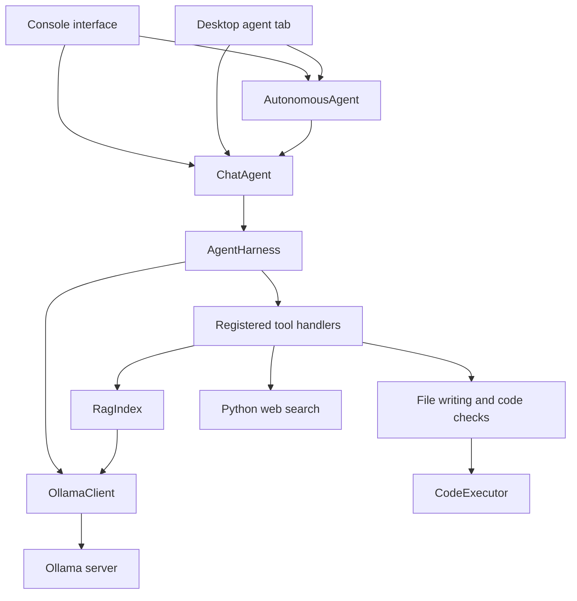

# Local AI Agent

A native **C++17 AI assistant for Windows**, powered by models served through **Ollama**. Chat through a desktop window or the command line, search a local document collection, retrieve information from the web, and create or execute scripts on your computer.

The default assistant is **Sof_IA**. The desktop interface also supports additional agents with their own names, models, instructions, and conversations.

The application implements its own tool-calling harness, retrieval index, execution layer, and GUI integration. Model inference runs in Ollama; PDF extraction and web search use Python helpers.

## Contents

- [Features](#features)
- [Requirements](#requirements)
- [Build and first run](#build-and-first-run)
- [Usage](#usage)
- [Knowledge base and PDF ingestion](#knowledge-base-and-pdf-ingestion)
- [Configuration](#configuration)
- [Architecture](#architecture)
- [Code reference](#code-reference)
- [Extending the agent](#extending-the-agent)
- [Execution controls and data handling](#execution-controls-and-data-handling)
- [Packaging and recovery](#packaging-and-recovery)
- [Troubleshooting](#troubleshooting)
- [Development and validation](#development-and-validation)
- [License and dependencies](#license-and-dependencies)

## Features

- **Desktop and console interfaces:** Dear ImGui with Win32/Direct3D 11, plus interactive, single-prompt, and piped CLI input.
- **Streaming replies:** display model output as it arrives, with tool activity and cancellation support.
- **Multiple agent tabs:** independent conversations and worker threads, with persistent agent definitions.
- **Autonomous tasks:** work through a goal over several steps, with completion, repetition, failure, and step-limit checks.
- **Document retrieval:** BM25 keyword search combined with embedding similarity using reciprocal rank fusion.
- **Incremental indexing:** reuse unchanged passages and embeddings, with a persistent binary index and resumable embedding generation.
- **PDF ingestion:** extract text into JSON; optional Portuguese/English OCR.
- **Internet search:** DuckDuckGo, Bing, and Wikipedia fallbacks, with relevant text extracted from result pages.
- **File creation and script execution:** write text files and run Python, Windows PowerShell, or CMD with bounded subprocess resources.
- **Editable configuration:** shared settings, machine-specific overrides, agent-specific overrides, and external prompt files.

## Requirements

### Runtime

| Dependency | Purpose |
| --- | --- |
| Windows 10/11, 64-bit | Win32 APIs, WinHTTP, process management, and the desktop application. |
| [Ollama](https://ollama.com/) | Serves the chat model and optional embedding model, on this computer or another reachable host. |
| Chat model with tool support | Required for document search, web search, file creation, and execution. The committed settings select `llama3.1:8b`. |
| `bge-m3` | Embedding model selected by the committed configuration. Optional when using keyword-only retrieval. |
| Python 3, available as `python` on `PATH` | Web search, PDF ingestion, Python execution, and Python syntax checks. Native document retrieval itself runs in C++. |
| [PyMuPDF](https://pymupdf.readthedocs.io/) | Required by `scripts/reader.py` for PDF extraction. |
| Tesseract with `por` and `eng` language data | Required only for `reader.py --ocr`. |
| Direct3D 11 runtime and compatible rendering support | Required for the GUI. The host attempts WARP software rendering if hardware creation reports unsupported. |

Memory and inference speed depend on the model, quantization, context window, and number of active agents. The repository does not define a fixed RAM or VRAM minimum.

### Build tools

- PowerShell.
- [MSYS2](https://www.msys2.org/) **UCRT64** GCC/G++, with C++17 support.
- [nlohmann/json](https://packages.msys2.org/packages/mingw-w64-ucrt-x86_64-nlohmann-json) headers in the compiler's include path.
- Git to clone the repository.

Dear ImGui is included in [`third_party/imgui`](third_party/imgui). The build links Windows system libraries and statically links the GCC runtime; it does not bundle Ollama, models, Python, PyMuPDF, or Tesseract.

## Build and first run

### 1. Clone the repository

```powershell
git clone https://github.com/JC4Job/Local-AI-Agent.git
cd Local-AI-Agent
```

### 2. Install compiler dependencies

In the **MSYS2 UCRT64 terminal**:

```bash
pacman -S --needed mingw-w64-ucrt-x86_64-gcc mingw-w64-ucrt-x86_64-nlohmann-json
```

Back in **PowerShell**, make the UCRT64 compiler available for this session. Adjust the path if MSYS2 is installed elsewhere:

```powershell
$env:Path = "C:\msys64\ucrt64\bin;$env:Path"
g++ --version
python --version
```

For PDF ingestion:

```powershell
python -m pip install pymupdf
```

### 3. Configure the Ollama endpoint

Edit [`config/settings.txt`](config/settings.txt). For Ollama running on the same computer, use:

```ini
model = llama3.1:8b
endpoint = http://127.0.0.1:11434/api/chat
embed_model = bge-m3
embed_num_ctx = 1024
num_ctx = 16384
num_predict = 4096
```

**The checked-in configuration points to `http://172.10.0.58:11434/api/chat`.** Replace it unless that is your intended server. The endpoint must include `/api/chat`; the client derives `/api/embed` and `/api/tags` from the same server.

If `config/machines/<computer-name>.txt` already exists, its values override `settings.txt`. See [configuration precedence](#configuration-precedence).

### 4. Install the models

For a local Ollama server:

```powershell
ollama pull llama3.1:8b
ollama pull bge-m3
ollama show llama3.1:8b
```

Check the model's reported capabilities for tool support. For a remote endpoint, install the models on that server; pulling models into an unrelated local Ollama instance will not make them available remotely.

### 5. Build

```powershell
.\build.ps1 -Clean
```

A clean first build avoids reusing the object files currently tracked under `build/`. Later incremental builds can use:

```powershell
.\build.ps1
```

| Output | Function |
| --- | --- |
| `bin/agent_gui.exe` | Desktop chat and agent tabs. |
| `bin/agent.exe` | Console chat, autonomous tasks, and knowledge indexing. |
| `bin/restore_config.exe` | Configuration recovery utility. |

`build.ps1` compiles Dear ImGui objects into `build/` and reuses them when their `.cpp` timestamps have not changed. Use `-Clean` after changing vendored headers or switching toolchains.

### 6. Prepare folders, warm up models, and launch

```powershell
New-Item -ItemType Directory -Force data\knowledge, workspace | Out-Null
.\run.ps1
.\bin\agent_gui.exe
```

`run.ps1` checks the configured server, attempts to start **local** `ollama serve` if it is unreachable, verifies that the configured models exist, and warms up embeddings before the chat model. It **does not download models or launch the GUI**.

For a remote endpoint, start and verify Ollama on the remote host first: the script cannot start a remote service. It reads shared and machine settings, but does not preload every custom agent's model.

To change the warm-up keep-alive duration:

```powershell
.\run.ps1 -KeepAlive 2h
```

## Usage

### Desktop interface

```powershell
.\bin\agent_gui.exe
```

| Control | Behavior |
| --- | --- |
| **Send** / **Enter** | Send one chat message. |
| **Ctrl+Enter** | Insert a newline in the input. |
| **Run task** | Treat the input as an autonomous goal. |
| **Stop** | Cancel generation or an autonomous run. A running tool may finish or reach its own timeout first. |
| **New chat** | Clear the current chat, search cache, and displayed history; refresh the document index on the next search. |
| **Settings** | Change the selected agent's model, limits, and supported settings. |
| **+** | Create an agent with a name, model, and instructions. |
| **Delete agent** | Remove a custom agent definition after backing it up. |
| **Copy** / text selection | Copy a reply or selected text. |

Agent definitions reopen at startup. **Conversations are held in memory and are not restored after restarting.** Each tab's chat and autonomous task agent have separate conversation state, even though their messages appear in the same tab.

Multiple tabs can work concurrently, but actual model concurrency and loading behavior depend on Ollama and available resources.

### Console interface

Interactive chat:

```powershell
.\bin\agent.exe
```

Single question:

```powershell
.\bin\agent.exe "What do my documents say about digital transformation?"
```

Piped input:

```powershell
Get-Content .\question.txt -Raw | .\bin\agent.exe
```

In interactive mode, a trailing backslash or backtick continues input onto the next line. Enter `exit`, `quit`, `done`, or `sair` to exit; empty input also ends the session.

The CLI recognizes `--index` and `--auto`; it does not implement a general `--help` option or a custom-agent selection flag.

### Autonomous tasks

```powershell
.\bin\agent.exe --auto "Create hello.py in the workspace, print Hello from Sof_IA, run it, and report the output."
```

```powershell
Get-Content .\goal.txt -Raw | .\bin\agent.exe --auto
```

Each task starts a fresh conversation. A step can contain multiple rounds of tool calls. The runner stops when it receives a completion summary, encounters a model failure, reaches the step limit, detects two consecutive steps without new actions, or is cancelled.

After a step performs actions, the runner can ask the model whether the goal is complete with only `finish` available. This reduces accidental repetition. An empty `finish` summary is rejected; a subsequent nonempty reply can be accepted as the final result.

**Autonomous mode retains execution confirmations.** Flagged operations can pause for an interactive answer; piped input cannot approve them. The autonomous prompt's instruction to work independently does not bypass the C++ confirmation handler.

| CLI operation | Exit behavior |
| --- | --- |
| Chat | Normally returns `0`, including errors returned as chat text; inspect output for failures. |
| `--auto` | `0` for `Finished`, `1` for other outcomes, `2` for an empty goal. `Finished` can also report that a task was impossible. |
| `--index` | `1` for caught exceptions; embedding failures reported in the summary can still return `0`. Inspect the summary. |

For indexing and autonomous mode, the first **Ctrl+C** requests a clean stop. A second allows normal process termination. Indexing stops after the current embedding batch.

### Tools exposed to the model

Defined in [`ChatAgent::RegisterTools()`](src/agent/ChatAgent.hpp) and the [`AutonomousAgent` constructor](src/agent/AutonomousAgent.hpp):

| Tool | Arguments | Behavior |
| --- | --- | --- |
| `write_file` | `path`, `content` | Create or replace a text file and create its parent folders. Relative paths resolve under `workspace_dir`. |
| `execute_code` | `language`, `code` | Execute Python, PowerShell, or CMD and return exit status, elapsed time, stdout, and stderr. |
| `search_knowledge_base` | `query` | Retrieve source-labeled passages through the native RAG index. |
| `search_internet` | `query` | Run the Python web search helper. |
| `finish` | `summary` | End an autonomous task with its result. Available only in autonomous mode. |

`write_file` saves content; it does not execute it. `execute_code` uses a temporary script and does not preserve the submitted code as a user file. To save and run a script, the agent must use both tools.

## Knowledge base and PDF ingestion

### Convert PDFs into searchable JSON

The application indexes **JSON documents**, not PDF files directly. Convert a PDF with [`scripts/reader.py`](scripts/reader.py):

```powershell
python .\scripts\reader.py --file "C:\Documents\study.pdf"
```

Without `--output`, the script creates a UUID-named JSON file in `data/knowledge/`, relative to the script's location. To choose a filename:

```powershell
python .\scripts\reader.py --file "C:\Documents\study.pdf" --output ".\data\knowledge\study.json"
```

For a scanned PDF:

```powershell
python .\scripts\reader.py --file "C:\Documents\scan.pdf" --output ".\data\knowledge\scan.json" --ocr
```

OCR uses `por+eng`, 300 DPI, and `full=False`. Install the corresponding Tesseract language data and configure `TESSDATA_PREFIX` if it cannot be located.

A batch example for one directory:

```powershell
Get-ChildItem "C:\Documents\Studies" -Filter *.pdf -File | ForEach-Object {
    python .\scripts\reader.py --file $_.FullName
}
```

Each invocation without `--output` creates a new document. Use stable explicit output paths when replacing earlier imports to avoid duplicates.

### Document format

```json
{
  "FileMeta": {
    "FileName": "study.pdf",
    "FileDestination": "data/knowledge/study.json",
    "TimeStamp": "2026-11-16T12:00:00+00:00"
  },
  "Content": "--- Page 1 ---\nText from the first page.\n\n--- Page 2 ---\nText from the second page."
}
```

The native reader requires a JSON object with a string `Content`. `FileMeta.FileName` supplies the displayed document name; the JSON filename is the fallback. The exact `--- Page N ---` markers supply page references. `FileDestination` and `TimeStamp` are extraction metadata, not search filters.

JSON files are discovered recursively under `knowledge_dir`. If you customize that setting, direct `reader.py --output` into the same folder: the Python helpers do not read `settings.txt`.

### Build embeddings

```powershell
.\bin\agent.exe --index
```

This synchronizes the index, then embeds passages without vectors. Progress is saved approximately every five minutes and at the end when vectors have been generated. A clean Ctrl+C preserves completed progress after the current batch; run the command again to continue.

New documents are searchable by keywords after synchronization. They become searchable by meaning after embedding. Start **New chat** or restart the application after changing the corpus or running indexing in another process.

### How retrieval works

1. Scan JSON file sizes and modification times; reparse added or changed documents and remove deleted entries.
2. Split content into passages of approximately **1,000 UTF-8 bytes**, with approximately **150 bytes of overlap**, respecting word and UTF-8 boundaries. The source names these settings `chunk_chars` and `overlap_chars`, but C++ string sizes count bytes.
3. Rank by BM25 over normalized text and document titles, with accent folding, stopword removal, and light English/Portuguese stemming.
4. If embeddings are available, embed the query and compare it with stored, normalized, int8-quantized passage vectors.
5. Combine keyword and semantic rankings using reciprocal rank fusion.
6. Return a bounded selection with document names and page references, rather than loading entire documents into the model context.

The committed limits are six passages and a 4,000-character-named result budget. Native string budgets are byte-based, and result headers add overhead. If query embedding fails, retrieval falls back to keywords. If the chat server is unavailable, retrieval fallback does not make model generation available.

The persistent index is `data/rag/knowledge.idx`. Missing, incompatible, or damaged indexes are rebuilt from source JSON. Changing the embedding model invalidates its saved vectors. Similarity thresholds are tuned in code for `bge-m3`; they may need adjustment for another embedding model.

### Standalone helper scripts

```powershell
python .\scripts\listdata.py
python .\scripts\listdata.py digital transformation
python .\scripts\websearch.py --pages 3 --max-chars 6000 --budget 8 -- "C++ retrieval augmented generation"
```

`listdata.py` is a separate keyword-only inspection utility, with its own limits and fixed `data/knowledge` path. The agent's `search_knowledge_base` tool uses `RagIndex`, not this script.

`websearch.py` uses the Python standard library. It tries configured sources in order, reads selected result pages within a time budget, and keeps snippets when page extraction fails. It does not render JavaScript or ingest PDFs from search results.

## Configuration

### Configuration precedence

Values are loaded in this order; later values override earlier ones:

1. Built-in defaults in [`ChatAgentConfig`](src/agent/AgentConfig.hpp).
2. [`config/settings.txt`](config/settings.txt).
3. `config/machines/<computer-name>.txt`.
4. `config/agents/<agent-name>.txt`, when loading a custom GUI agent.

Settings files use `key = value`, with blank lines and whole-line `#` comments. Inline comments are not supported. Unknown keys and invalid numeric values produce startup notes and are ignored.

Paths supplied in settings files are relative to **`config/`**, including settings in the `machines/` and `agents/` subfolders. For example, `knowledge_dir = ..\data\knowledge` points to the project data directory.

Manual file edits take effect after restarting. GUI Settings applies its supported fields to idle agents for the next message while retaining conversations. Endpoint, embedding-model name, directories, timeout, and tool-description changes require restarting.

### Models and limits

These are the **committed `settings.txt` values**, before any overrides:

| Key | Value | Meaning |
| --- | --- | --- |
| `agent_name` | `Sof_IA` | Default display name. |
| `model` | `llama3.1:8b` | Chat model. Built-in/recovery default is `llama3.2`. |
| `endpoint` | `http://172.10.0.58:11434/api/chat` | Ollama chat URL. Built-in/recovery default uses `127.0.0.1`. |
| `embed_model` | `bge-m3` | Embedding model; leave empty for keyword-only retrieval. |
| `embed_num_ctx` | `1024` | Embedding context window. |
| `num_ctx` | `16384` | Total chat context window. |
| `num_predict` | `4096` | Maximum reply tokens; must be less than `num_ctx`. |
| `max_tool_rounds` | `5` | Tool-call rounds per message; a round can contain several calls. |
| `code_timeout_ms` | `10000` | Execution/search subprocess timeout in milliseconds. Does not govern chat or embedding HTTP timeouts. |
| `autonomous_max_steps` | `10` | Maximum work steps per autonomous task. |
| `kb_max_passages` | `6` | Maximum retrieved passages. |
| `kb_max_result_chars` | `4000` | Native retrieval text budget. |
| `web_sources` | `duckduckgo, bing, wikipedia` | Search source order. |
| `web_pages_to_read` | `3` | Number of top result pages to read; `0` keeps snippets. |
| `web_max_result_chars` | `6000` | Web helper output character budget. |

The harness reserves `num_predict` from `num_ctx` for the reply. When its approximate token budget is exceeded, it shortens older tool results while retaining full search results in a bounded in-memory cache. This is an estimate, not exact model tokenization; long conversations can still overflow.

### Paths, prompts, and routing

| Key | Committed value or role |
| --- | --- |
| `scripts_dir` | `..\scripts` |
| `knowledge_dir` | `..\data\knowledge` |
| `rag_index` | `..\data\rag\knowledge.idx` |
| `workspace_dir` | `..\workspace` |
| `system_prompt_file` | `system_prompt.txt` |
| `autonomous_prompt_file` | `autonomous_prompt.txt` |
| `file_task_actions` | Comma-separated action words used to recognize file tasks. |
| `file_task_objects` | Comma-separated file/object words used with action words. |
| `search_words` | Words that keep search tools available even for a file task. |
| `internet_words` | Explicit internet triggers: `internet, online, wikipedia, google`. |
| `words_before_web` | Words that make `web` an explicit search trigger: `the, on, na, da, pela`. |
| `tool_write_file`, `tool_execute_code` | Descriptions supplied to the model for file/execution tools. |
| `tool_search_knowledge_base`, `tool_search_internet` | Descriptions supplied to the model for retrieval tools. |
| `tool_finish` | Autonomous completion tool description. |

File-task recognition requires a word from both action and object lists. Unless a search trigger is also present, the harness hides search tools for that message or autonomous run. These are configurable word heuristics, not semantic intent classification.

For ordinary factual requests, C++ enforces knowledge-base-first ordering if the model attempts internet search too early. Explicit internet requests reverse the ordering. The prompt describes additional behavior; prompt instructions alone are not hard guarantees.

The system and autonomous prompts live in [`config/system_prompt.txt`](config/system_prompt.txt) and [`config/autonomous_prompt.txt`](config/autonomous_prompt.txt). Missing or empty prompts fall back to matching files in [`config/defaults`](config/defaults), then to short built-in prompts.

### Custom agent definitions

The GUI writes `config/agents/<name>.txt`. For example:

```ini
agent_name = Researcher
model = llama3.1:8b
num_ctx = 16384

---
Summarize the user's documents and cite the document names and pages returned by retrieval.
```

Text after `---` is appended to the system prompt as the agent's instructions. Omitted settings inherit the shared/machine values. The GUI keeps the model explicit and removes numeric overrides that match the default agent, allowing those values to follow later default changes.

The default agent's GUI settings are saved to the current computer's machine file. Custom-agent settings are saved to their agent files. Additional agents are independent sessions, not a coordinated delegation system.

## Architecture



A chat request enters `ChatAgent::Ask()`, which chooses tool visibility and initializes request state. `AgentHarness::ProcessPrompt()` sends messages and schemas to Ollama, dispatches returned tool calls sequentially, appends tool results, and asks the model to continue. It ends on a final reply, cancellation, a terminal tool, a failure, or the tool-round limit.

`AutonomousAgent::Run()` drives successive calls to the same core using task-progress notes. The GUI runs blocking agent work on per-tab workers and transfers events to the UI thread through an inbox. CLI and GUI share the same agent implementation.

## Code reference

The links below point to implementation files. Public interfaces are listed separately from important internal methods so contributors can locate behavior without treating private helpers as callable APIs.

### Entry points and automation scripts

| File | Main symbols or commands | Responsibility |
| --- | --- | --- |
| [`src/cli/cli_main.cpp`](src/cli/cli_main.cpp) | `main`, `RunAutonomous`, `IndexKnowledgeBase`, `ConfirmAtConsole`, `OnCtrlC` | CLI dispatch, console streaming, confirmations, and clean-stop handling. |
| [`src/gui/gui_main.cpp`](src/gui/gui_main.cpp) | `main` | Create `GuiHost` and `ChatWindow`, then run the render loop. |
| [`src/tools/restore_config.cpp`](src/tools/restore_config.cpp) | `main`, `Restore`, `AskToGoOn` | Back up configuration and restore defaults. |
| [`build.ps1`](build.ps1) | `-Clean` | Compile cached ImGui objects and build all three executables. |
| [`run.ps1`](run.ps1) | `-KeepAlive` | Read effective default-agent model settings and warm up Ollama. |
| [`package.ps1`](package.ps1) | `-NoData`, `-Zip` | Rebuild and assemble a relocatable distribution. |

### Agent core

| File / type | Public entry points | Internal implementation to inspect |
| --- | --- | --- |
| [`AgentConfig.hpp` — `ChatAgentConfig`](src/agent/AgentConfig.hpp) | `Load`, `Apply`, `SaveMachineSettings`, `SaveAgentSettings`, `CreateAgentFile`, `DeleteAgentFile`, `DefaultSettingsText` | `ReadSettings`, `Set`, `SetNumber`, `Resolve`, and `ReadPromptFile` implement parsing, validation, precedence, and fallback. |
| [`ChatAgent.hpp` — `ChatAgent`](src/agent/ChatAgent.hpp) | `Ask`, `ContinueTask`, `NewConversation`, `IndexKnowledgeBase`, `ApplySettings`, `RegisterTool`, `Cancel` | `RegisterTools`, `AsksForFile`, `AsksForInternet`, `SearchDocuments`, `SearchWeb`, `WriteFile`, and `ExecuteCode` connect requests to actions. |
| [`AgentHarness.hpp` — `AgentHarness`](src/agent/AgentHarness.hpp) | `ProcessPrompt`, `RegisterTool`, `SetHiddenTools`, `SetOnlyTools`, `SetContextBudget`, `ResetConversation`, `Cancel` | `RunToolCalls`, `RecoverTextToolCalls`, `FitContext`, and `SendChat` implement dispatch, recovery of tool JSON written as text, context compaction, and plain-chat fallback. |
| [`AutonomousAgent.hpp` — `AutonomousAgent`](src/agent/AutonomousAgent.hpp) | `Run`, `Cancel`, `SetStepHandler`, `SetConfirmHandler`, `ApplySettings` | `Finish`, `Over`, `CheckMessage`, and `NextStep` manage completion, progress checks, and continuation prompts. |
| [`ToolResultCache.hpp` — `ToolResultCache`](src/agent/ToolResultCache.hpp) | `MakeKey`, `Find`, `Store`, `Clear`, `Size` | LRU cache of up to 64 search results by default. Keys normalize word order, duplicate words, and ASCII case. |

`ChatAgent` also exposes `SetStreamHandler`, `SetConfirmHandler`, `LastAsk`, `LastAskRepeats`, and `TaskLog` for front ends and task orchestration. `AgentHarness::PromptStats` reports tool-call count and model failure; `AutonomousAgent::Result` contains `outcome`, `steps`, and `summary`.

`Ask()`, `ContinueTask()`, `Run()`, and indexing are blocking operations. Do not call them concurrently on the same instance. Settings and handler changes are intended while idle; `Cancel()` is designed for another thread.

### Model transport and retrieval

| File / type | Main symbols | Responsibility |
| --- | --- | --- |
| [`OllamaClient.hpp` — `OllamaClient`](src/llm/OllamaClient.hpp) | `Chat`, `Embed`, `ListModels`, `SetOptions` | WinHTTP transport for `/api/chat`, `/api/embed`, and `/api/tags`. `StreamedReply` assembles newline-delimited JSON, content, tool calls, and final metadata. |
| [`OllamaClient.hpp` — `CancelToken`](src/llm/OllamaClient.hpp) | `Cancel`, `Reset`, `Cancelled` | Abort an active chat HTTP request by closing its handle. |
| [`RagIndex.hpp` — `RagConfig`](src/rag/RagIndex.hpp) | Configuration fields | Chunk sizes, overlap, retrieval limits, batching, embedding timeouts, and relevance thresholds. Only a subset is exposed through text settings. |
| [`RagIndex.hpp` — `RagIndex`](src/rag/RagIndex.hpp) | `Sync`, `EmbedPending`, `Search`, `SetLimits`, `PendingCount` | Incremental corpus synchronization, embedding generation, and retrieval. Call `Sync()` before `Search()`. |

Useful internal retrieval methods:

| Methods | Purpose |
| --- | --- |
| `ScanSources`, `ReadDocument`, `SplitIntoPassages` | Discover JSON documents, validate content, and build page-aware passages. |
| `Rebuild`, `KeepVectors` | Update changed documents and reuse vectors for unchanged passage text and title. |
| `ForEachTerm`, `Stem`, `BuildPostings`, `RankByWords` | Normalize words, build postings, and rank with BM25. |
| `EmbeddingText`, `Quantize`, `DotI8`, `RankByMeaning` | Embed title plus passage, quantize vectors, and rank semantic matches. |
| `Search`, `SourceOf`, `FormatPassage` | Fuse rankings and format bounded source-labeled output. |
| `Load`, `Save` | Validate the binary index and replace it through a temporary file. |

The index stores source metadata, passage text, page bounds, embedding model, and quantized vectors. Keyword postings are rebuilt in memory. Semantic ranking scans stored passage vectors; there is no external vector database or approximate-nearest-neighbor service.

### Execution and platform helpers

| File / type | Main symbols | Responsibility |
| --- | --- | --- |
| [`CLISecurityChecking.hpp` — `CLISecurityChecking`](src/execution/CLISecurityChecking.hpp) | `Check`, `Report`, `Finding`, `ConfirmHandler`; internal `RuleTable` | Pattern-based detection of risky commands, with severity, evidence, and line references. |
| [`CodeExecutor.hpp` — `CodeExecutor`](src/execution/CodeExecutor.hpp) | `ExecuteCode`, `ExecuteCommand`, `Limits`, `ExecutionResult` | Temporary scripts, process creation, Job Objects, output capture, timeouts, and UTF-8 normalization. |
| [`FileSystem.hpp` — `FileSystem`](src/framework/FileSystem.hpp) | `BasePath`, `RelativePathToOSPath`, global `fileSystem` | Resolve application resources independently of the shell's working directory. |
| [`Sys.hpp`](src/sys/Sys.hpp) | `Sys_EXEPath`, `Sys_DefaultBasePath`, `Sys_FontsFolder`, `Sys_MachineName`, `Sys_OwnsConsole` | Windows executable/resource discovery, font path, machine identity, and console ownership. |
| [`CLIHelper.hpp` — `CLIHelper`](src/cli/CLIHelper.hpp) | `CaptureCLIInput`, `StdinIsConsole` | UTF-8 command-line input, piped input, and multiline continuation. |
| [`Utils.hpp`](src/common/Utils.hpp) | `TextUtilities::print`, `Widen` | Flushed console output and UTF-8-to-UTF-16 conversion. |
| [`MacroWrap.h`](src/common/MacroWrap.h) | `PRINT` | Compatibility macro forwarding to `TextUtilities::print`. |

`ExecutionResult` separates launch errors from the child's exit status and includes `stdout_str`, `stderr_str`, `timed_out`, `truncated`, and `elapsed_ms`. `ExecuteCommand()` invokes a process without inserting a shell; `ExecuteCode()` explicitly builds a shell/interpreter invocation.

### Desktop interface

| File / type | Main symbols | Responsibility |
| --- | --- | --- |
| [`GuiHost.hpp` — `GuiHost`](src/gui/GuiHost.hpp) | `Create`, `Run`, `Window`; internal `WndProc`, `CreateDevice`, `LoadFont`, `Shutdown` | Native window, DPI scaling, Direct3D resources, fonts, render loop, and cleanup. |
| [`ChatWindow.hpp` — `ChatWindow`](src/gui/ChatWindow.hpp) | `Draw`; internal `DrawTabs`, `DrawSettings`, `SaveSettings`, `CreateAgent`, `DeleteAgent`, `DrawConfirmation` | Tab management, settings persistence, model selection, and confirmation dialogs. |
| [`AgentTab.hpp` — `AgentTab`](src/gui/AgentTab.hpp) | `Poll`, `DrawBody`, `NewConversation`, `ApplySettings`, `Answer` | Per-agent display and state. Internal `Send`, `RunTask`, `DrainInbox`, and `Session::Confirm` connect workers to the UI. |
| [`UiCommon.hpp` — `ui`](src/gui/UiCommon.hpp) | `SelectableText::Draw`, `Wrapped`, `Dim`, `Trim`, `ShortPath` | Shared presentation helpers and selectable wrapped text that copies original line breaks. |

The vendored Dear ImGui version is **1.91.8**. This repository adds `ImGui::StyleColorsSofia`, declared in [`imgui.h`](third_party/imgui/imgui.h) and implemented in [`imgui_draw.cpp`](third_party/imgui/imgui_draw.cpp). Preserve that customization when upgrading ImGui. Win32 and DX11 backends and `misc/cpp/imgui_stdlib` are compiled by the build script.

### Python utilities

| File | Main functions / entry point | Responsibility |
| --- | --- | --- |
| [`scripts/reader.py`](scripts/reader.py) | `__main__`, `--file`, `--output`, `--ocr` | Extract PDF text with optional OCR and write the document JSON format. |
| [`scripts/listdata.py`](scripts/listdata.py) | `load_documents`, `normalize`, `search`, `list_documents`, `main` | Inspect the default corpus and perform independent keyword-window search. |
| [`scripts/websearch.py`](scripts/websearch.py) | `search_duckduckgo`, `search_bing`, `search_wikipedia`, `read_pages`, `PageText`, `main` | Search-source fallback, concurrent page fetching, text/date extraction, and output budgeting. |

`websearch.py` also defines `Result`, `Deadline`, and `tls_context`. Its TLS context keeps certificate-chain and hostname validation but disables `VERIFY_X509_STRICT` for compatibility with a corporate inspection certificate described in the source.

### Runtime directories

| Path | Contents |
| --- | --- |
| `bin/` | Compiled executables. |
| `build/` | Cached ImGui objects; generated, although some objects are currently tracked. |
| `config/` | Shared settings and active prompts. |
| `config/defaults/` | Factory prompt copies. |
| `config/machines/` | Generated machine-specific overrides. |
| `config/agents/` | Generated custom-agent definitions. |
| `config/backup/` | Timestamped configuration/agent backups. |
| `data/knowledge/` | Imported document JSON files. |
| `data/rag/` | Persistent retrieval index. |
| `workspace/` | Default destination for generated files and execution working directory. |
| `dist/agent/` | Distribution produced by `package.ps1`. |

Some directories appear only after setup or use. The application searches beside the executable and its parent for resource folders, allowing `bin/` and its sibling resources to move together.

## Extending the agent

### Register a native tool

`ChatAgent::RegisterTool()` accepts a tool name, description, JSON parameter schema, handler, and optional `ends_prompt` flag. Register tools before the first request. For example, inside an existing application translation unit that includes `agent/ChatAgent.hpp`:

```cpp
ChatAgent agent(nullptr, ChatAgentConfig::Load());

agent.RegisterTool(
    "add_numbers",
    "Adds two numbers and returns their sum.",
    json{
        {"type", "object"},
        {"properties", {
            {"a", {{"type", "number"}}},
            {"b", {{"type", "number"}}}
        }},
        {"required", json::array({"a", "b"})}
    },
    [](const json& args) -> std::string {
        const double a = args.at("a").get<double>();
        const double b = args.at("b").get<double>();
        return json{{"sum", a + b}}.dump();
    }
);

const std::string reply = agent.Ask("Use add_numbers to add 12 and 30.");
```

Handler exceptions are returned to the model as tool errors. New handlers do not automatically inherit the built-in file/execution checks; implement validation and confirmation appropriate to their actions. Use `ends_prompt = true` only when a successful tool call should terminate the current prompt.

For changes shared by both front ends, add the registration to `ChatAgent::RegisterTools()`. If introducing a configurable description, update `ChatAgentConfig` fields, `Set()`, `DefaultSettingsText()`, and `config/settings.txt` together.

### Other extension points

- **Retrieval tuning:** change `RagConfig` and ranking/chunking code in `RagIndex.hpp`. Update index compatibility/version handling when changing persisted data or passage semantics.
- **Search providers:** add a provider function and a `SOURCES` entry in `websearch.py`, then select it through `web_sources`.
- **Prompt behavior:** edit active prompt files; update factory copies only when intentionally changing recovery defaults.
- **GUI behavior:** keep ImGui work on the UI thread and send worker results through `AgentTab::Session` events.
- **Execution languages:** update the interpreter mapping in `CodeExecutor`, tool schema/descriptions, and security checks together.

## Execution controls and data handling

The execution layer uses Windows Job Objects to constrain subprocesses:

| Limit | Default | Configuration |
| --- | --- | --- |
| Timeout | 10 seconds | `code_timeout_ms` |
| Committed memory | 512 MiB per job | `CodeExecutor::Limits` in code |
| Concurrent processes | 32 per job | `CodeExecutor::Limits` in code |
| Captured output | 16 KiB for each of stdout and stderr | `CodeExecutor::Limits` in code |
| Standard input | EOF | Noninteractive child processes |

These subprocess limits do not cap Ollama's model memory. Remaining child processes are terminated when execution ends, including on timeout.

`CLISecurityChecking` flags recognized patterns involving deletion, system changes, software installation, network access, dynamic evaluation, and other operations. Both caution and danger findings require approval through the installed front-end handler. Writing outside the workspace or writing flagged script content also requests approval. Unflagged workspace files can be replaced without an extra overwrite prompt.

**These checks are heuristic, not an isolation sandbox.** Processes run with the application's Windows user permissions; the workspace is a default working directory, not a filesystem boundary. A command that runs an existing script is not a comprehensive inspection of that script or its dependencies. Run the application with the permissions appropriate to the work you allow it to perform.

Data flow depends on configuration:

- Chat messages, tool results, and retrieved document passages go to the configured Ollama endpoint.
- Passage text is sent to that endpoint during embedding generation.
- Internet search sends queries to external providers and retrieves result pages. This built-in search path is not routed through the generated-code confirmation check.
- With a remote Ollama endpoint, inference data leaves the client computer. HTTP endpoints do not encrypt transport.
- Document JSON and the binary index contain readable document text; the application does not encrypt them at rest.
- Conversation caches are in memory. Successful repeated searches may be reused until eviction or **New chat**, so a repeated web query is not necessarily refreshed.

## Packaging and recovery

### Build a distribution

```powershell
.\package.ps1
.\package.ps1 -NoData -Zip
```

The script rebuilds the executables and recreates `dist/agent/`. It includes executables, shared configuration, factory prompts, custom-agent definitions, Python scripts, `run.ps1`, and a generated `README.txt`.

By default it also includes the knowledge JSON and saved index. `-NoData` excludes those documents and the index. Machine settings, configuration backups, and workspace outputs are not copied. `-Zip` also writes `dist/agent.zip`.

The package requires Python and Ollama/models to be installed or reachable on the destination machine. Review the packaged shared endpoint because machine overrides are excluded. Copy the complete folder layout rather than only an executable.

The packaging script scans files for the packaging computer's username and user-profile path. This is a targeted portability check, not general removal of private content. Custom instructions and documents can still be included. The script currently generates its own `README.txt`; it does not copy this `README.md` or license files. Include applicable project/dependency notices when redistributing.

### Restore configuration

```powershell
.\bin\restore_config.exe
```

For a deliberate noninteractive reset:

```powershell
.\bin\restore_config.exe --yes
```

The utility backs up files before replacing shared settings/prompts and removes the current machine's overrides. Backups are written to `config/backup/<timestamp>/`. It preserves custom agents, other machines' settings, and the knowledge base/index.

Recovery writes **built-in settings**, including `llama3.2` and the localhost endpoint, rather than restoring the repository's current `llama3.1:8b`/network-server configuration. Restart the application and verify the model and endpoint afterward.

## Troubleshooting

| Symptom | What to check |
| --- | --- |
| `g++` is not recognized | Add the MSYS2 UCRT64 `bin` directory to the PowerShell session's `PATH`. |
| `nlohmann/json.hpp` is missing | Install the UCRT64 nlohmann-json package using the same compiler environment. |
| Stale objects or link failures after a toolchain/header change | Run `build.ps1 -Clean`; incremental ImGui checks track source timestamps, not all header dependencies. |
| Empty/invalid model response | Check the effective endpoint, server reachability, and installed model. The committed endpoint is not localhost. |
| `run.ps1` starts local Ollama but keeps waiting | A configured remote endpoint remains unreachable; starting a local process cannot repair that server. |
| Model does not support tools | Select a tool-capable model. The harness falls back to plain chat and disables tool execution for that model. |
| Knowledge folder not found | Create `data/knowledge`, or correct `knowledge_dir` relative to `config/`. |
| Imported PDFs are not found | Convert them into JSON in the configured knowledge folder, then start a new chat. |
| Search is keyword-only | Check `embed_model`, install that model on the configured server, and run `agent.exe --index`. Inspect indexing output for embedding errors. |
| Search still uses old corpus/index state | Start a new chat or restart after changes or external indexing. |
| OCR cannot find `por.traineddata` or `eng.traineddata` | Install the Tesseract language data and check `TESSDATA_PREFIX`. |
| Python cannot start | Verify `python --version` in the environment used to launch the application. |
| Code times out or output is truncated | Check `code_timeout_ms` and the compiled resource/output limits. |
| A piped task refuses an operation | Flagged operations require an interactive confirmation; piped stdin cannot provide one. |
| Replies/tool calls are cut off | Review `num_predict`, keep it below `num_ctx`, and allow enough context for prompts, tools, and search results. |
| Settings edits seem ignored | Check machine and agent overrides, then restart for manually edited settings. |
| GUI cannot create its window | Check Direct3D availability; use the CLI to separate GUI problems from model problems. |
| Web search fails | Inspect provider errors; automated searches may be blocked or change format. Check network, proxy, and certificate configuration. |
| Multi-agent use is slow | Different models or context sizes can trigger reloads and compete for memory. Reduce concurrent work or adjust model/context choices. |

For a local-server connectivity check:

```powershell
Invoke-RestMethod http://127.0.0.1:11434/api/version
Invoke-RestMethod http://127.0.0.1:11434/api/tags
```

Substitute the configured server address when using remote inference.

## Development and validation

The repository uses PowerShell build scripts rather than CMake and currently has no checked-in automated test suite or CI workflow. Most application implementation is in headers, compiled through the GUI, CLI, and recovery entry points.

A practical Windows smoke check after changes is:

1. Run `build.ps1 -Clean` and confirm all three executables are produced.
2. Launch the CLI and GUI against the intended Ollama server.
3. Import a small PDF, run `--index`, and ask a question with a known answer and page.
4. Ask for a harmless script, verify the saved file, and run it through the agent.
5. Check interactive approval/refusal and piped-input refusal using disposable files.
6. Run a short autonomous task and verify its reported result against the actual output.
7. Create a custom agent, save settings, restart, and verify its definition reloads.
8. Package with `-NoData -Zip` and check the distribution's folder layout and endpoint.

**Documentation review:** this README was prepared from source revision [`0e30ad2`](https://github.com/JC4Job/Local-AI-Agent/tree/0e30ad23fc85b93b51613e65aaef2fff0d3551f6). Windows compilation, GUI execution, and end-to-end model behavior were not verified during that documentation review.

## License and dependencies

Created by **JC4Job — Júlio César Milani**. See the repository's [LICENSE](LICENSE), which contains MIT terms and the author's attribution request.

Dear ImGui has its own [MIT license notice](third_party/imgui/LICENSE.txt). Other tools, models, and dependencies retain their respective licenses.

Build dependency references:

- [MSYS2 UCRT64 GCC package](https://packages.msys2.org/packages/mingw-w64-ucrt-x86_64-gcc)
- [MSYS2 UCRT64 nlohmann-json package](https://packages.msys2.org/packages/mingw-w64-ucrt-x86_64-nlohmann-json)
